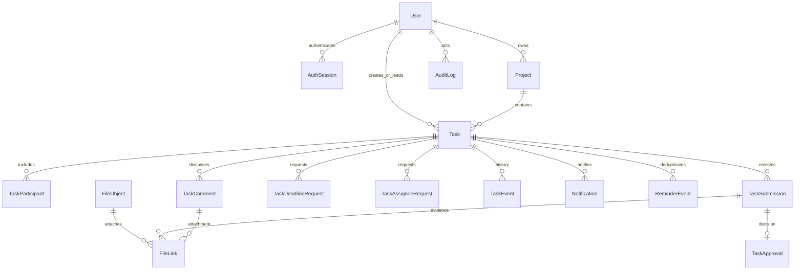

# Phase 01 database model

Source: [Phase 00 data model](../docs/backend-plan/phase-00/DATA_MODEL.md). [`schema.prisma`](./prisma/schema.prisma) and the committed SQL migration are the executable model. `recurrence_*`, `chat_*` and message file links wait for Phase 09.

All IDs are server-generated UUIDs. Historical foreign keys use `RESTRICT`; task events and audit rows reject update/delete. Submissions retain status transitions and approvals reference one submission each. Files are metadata only in PostgreSQL; R2 object keys and binary objects are handled in Phase 05.

The SQL migration adds constraints Prisma cannot express: case-insensitive email uniqueness and canonical lowercase email; one settings row; task progress, blocked reason and published OFFICIAL requirements; one pending submission/request per task; one active file link with exactly one TASK/SUBMISSION/COMMENT FK; and positive size/settings/counter values. Task, notification and reminder indexes support planned scoped queries. The `business_code_counters` composite key `(prefix, year)` supports an atomic PostgreSQL `INSERT ... ON CONFLICT ... RETURNING` allocation in `BusinessCodeService`.

`due_at`, `completed_at` and approval snapshots are `TIMESTAMPTZ(3)`. API timestamps use UTC; a date-only due date will be interpreted in `Asia/Ho_Chi_Minh` in Phase 03. KPI uses the completion due-date snapshot rather than the current due date, preserving historical on-time decisions after adjustments.
