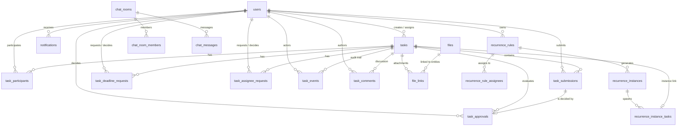
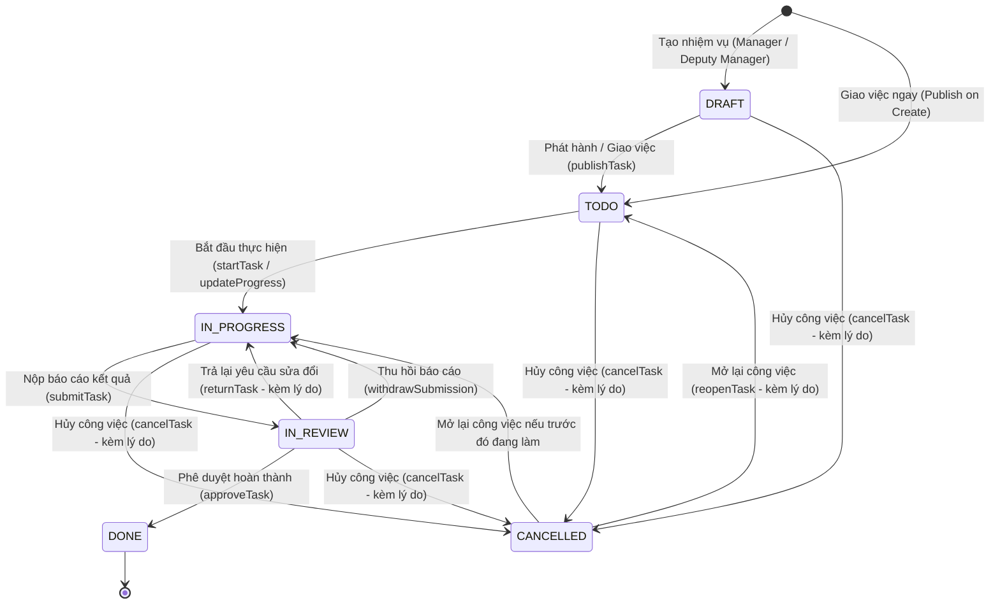
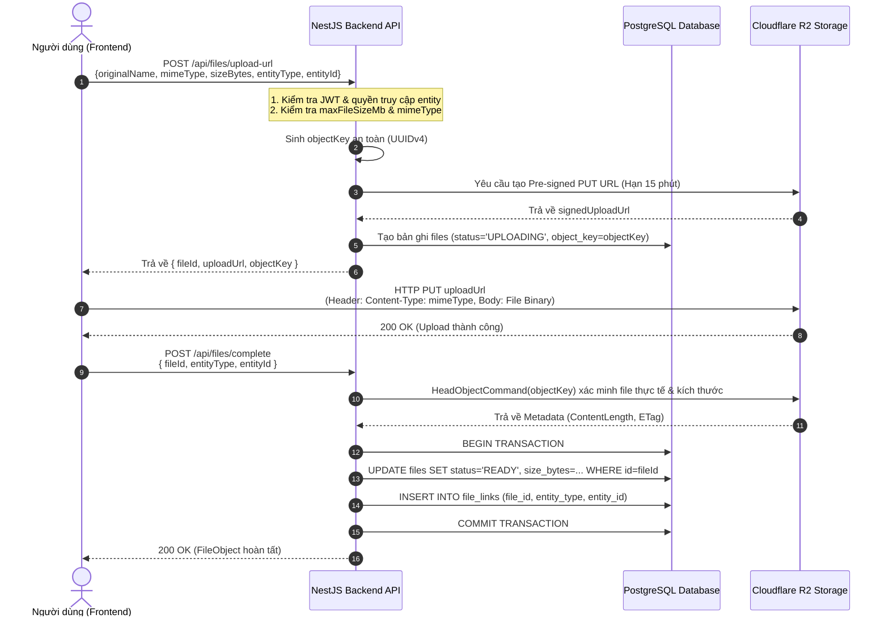

# TÀI LIỆU BÀN GIAO KỸ THUẬT FRONTEND SANG BACKEND
**Dự án:** Hệ thống Quản trị & Điều hành Công việc Nội bộ (Task Manager)  
**Kiến trúc mục tiêu Backend:** NestJS / PostgreSQL / Cloudflare R2 / Socket.IO  
**Cơ sở dữ liệu & Hợp đồng thực tế:** Dựa trên hợp đồng dữ liệu chuẩn tại [`Frontend/src/shared/data-contract.ts`](../Frontend/src/shared/data-contract.ts), dịch vụ nghiệp vụ [`Frontend/src/features/tasks/task-service.ts`](../Frontend/src/features/tasks/task-service.ts), bộ tính toán chỉ số [`Frontend/src/features/tasks/task-selectors.ts`](../Frontend/src/features/tasks/task-selectors.ts) và kịch bản kiểm thử mẫu [`Frontend/src/mocks/mock-seed.ts`](../Frontend/src/mocks/mock-seed.ts).  
**Ngày lập tài liệu:** 27/10/2026  
**Phiên bản:** 1.0 (Hoàn thiện giai đoạn Prototype UI/UX, sẵn sàng triển khai Backend)

---

## MỤC LỤC
1. [Sơ đồ Module Frontend & Điểm nối HttpRepository](#1-sơ-đồ-module-frontend--điểm-nối-httprepository)
2. [Bảng Đặc tả Màn hình / Hành động → REST API Endpoint & DTO](#2-bảng-đặc-tả-màn-hình--hành-động--rest-api-endpoint--dto)
3. [Mô hình Thực thể TypeScript & Đề xuất Lược đồ PostgreSQL (DDL)](#3-mô-hình-thực-thể-typescript--đề-xuất-lược-đồ-postgresql-ddl)
4. [Công thức KPI, Lọc phạm vi Dữ liệu & Endpoint Tổng hợp Server-Side](#4-công-thức-kpi-lọc-phạm-vi-dữ-liệu--endpoint-tổng-hợp-server-side)
5. [Quy tắc Thời gian, Xử lý Hạn chót, Phân trang & Sắp xếp](#5-quy-tắc-thời-gian-xử-lý-hạn-chót-phân-trang--sắp-xếp)
6. [Sơ đồ Chuyển đổi Trạng thái & Ma trận Phân quyền RBAC](#6-sơ-đồ-chuyển-đổi-trạng-thái--ma-trận-phân-quyền-rbac)
7. [Phương án Lưu trữ Tệp đính kèm Cloudflare R2 (Pre-signed URL)](#7-phương-án-lưu-trữ-tệp-đính-kèm-cloudflare-r2-pre-signed-url)
8. [Lộ trình Thay thế Mock bằng Giải pháp Production & Các quyết định Kỹ thuật](#8-lộ-trình-thay-thế-mock-bằng-giải-pháp-production--các-quyết-định-kỹ-thuật)
9. [Bộ Dữ liệu Kiểm thử Đối chiếu (Seed Scenarios & KPI Benchmarks)](#9-bộ-dữ-liệu-kiểm-thử-đối-chiếu-seed-scenarios--kpi-benchmarks)

---

## 1. SƠ ĐỒ MODULE FRONTEND & ĐIỂM NỐI HTTPREPOSITORY

### 1.1. Sơ đồ Kiến trúc Phân tầng Dữ liệu (Frontend Architecture)

Frontend được xây dựng theo kiến trúc phân tách rõ ràng 4 tầng:
1. **Presentation Layer (Components & Pages):** Các trang giao diện (`ManagerDashboard`, `StaffDashboard`, `TasksPage`, `TaskDetailPage`, `MembersPage`, `RecurrencePage`, `CalendarPage`, `FilesPage`, `ChatPage`, `ReportsPage`, `SettingsPage`, `AuditLogsPage`). Các trang này chỉ quản lý trạng thái hiển thị UI và gọi thông qua Custom Hooks hoặc Services.
2. **State & Custom Hooks Layer:** `useSession` (quản lý phiên đăng nhập và người dùng hiện tại), `useTasks` (truy vấn danh sách công việc), `useTaskStats` (thống kê chỉ số), `useSettings` (cấu hình hệ thống).
3. **Domain Service & Selectors Layer:**
   - `TaskService` (`task-service.ts`): Nơi tập trung toàn bộ quy tắc nghiệp vụ (Business Rules), lọc phạm vi hiển thị (`canSeeTask`), kiểm tra chuyển đổi trạng thái hợp lệ, tính toán trọng số ưu tiên.
   - `TaskSelectors` (`task-selectors.ts`): Tập hợp các hàm biến đổi thuần túy (pure functions) tính toán KPI, cảnh báo quá hạn (`isTaskOverdue`), phân bổ lịch (`CalendarDayBucket`), thống kê tải công việc (`getUserWorkloadStats`).
4. **Data Access Layer (Repository Abstraction):**
   - Hiện tại: `MockRepository` (`mock-repository.ts`) lưu trữ và xử lý in-memory / localStorage.
   - Mục tiêu triển khai Backend: Thay thế bằng `HttpRepository` (kết nối REST API NestJS qua `axios`/`fetch`) mà không làm thay đổi hợp đồng giao tiếp với các tầng trên.

```
+-----------------------------------------------------------------------------------+
|                        TẦNG TRÌNH DIỄN (UI PAGES & DIALOGS)                       |
| [ManagerDashboard] [StaffDashboard] [TasksPage] [TaskDetailPage] [MembersPage]    |
| [RecurrencePage]  [CalendarPage]   [FilesPage] [ChatPage]         [ReportsPage]   |
+-----------------------------------------------------------------------------------+
                                          |
                                          v
+-----------------------------------------------------------------------------------+
|                           TẦNG CUSTOM HOOKS & CONTEXT                             |
|          useSession()  |  useTasks()  |  useTaskStats()  |  useSettings()         |
+-----------------------------------------------------------------------------------+
                                          |
                                          v
+-----------------------------------------------------------------------------------+
|                      TẦNG DỊCH VỤ NGHIỆP VỤ & SELECTORS                           |
|       TaskService (task-service.ts)   |   TaskSelectors (task-selectors.ts)       |
|    - canSeeTask()                     |   - getManagerDashboardStats()            |
|    - isTaskOverdue()                  |   - getStaffDashboardStats()              |
|    - validateStatusTransition()       |   - getUserWorkloadStats()                |
+-----------------------------------------------------------------------------------+
                                          |
                                          v
+-----------------------------------------------------------------------------------+
|                     DATA ACCESS LAYER (REPOSITORY INTERFACE)                      |
|                                                                                   |
|            [HIỆN TẠI: MockRepository]      ===>      [MỤC TIÊU: HttpRepository]   |
|            - In-memory / localStorage                - Axios / Fetch HTTP Client  |
|            - Memory seed & listeners                 - JWT Bearer Token Headers   |
|            - Simulated delay                         - Socket.IO WebSockets       |
+-----------------------------------------------------------------------------------+
                                                              |
                                                              v
                                              +-------------------------------+
                                              |       NESTJS BACKEND API      |
                                              |  PostgreSQL / Cloudflare R2   |
                                              +-------------------------------+
```

### 1.2. Vị trí Tiêm phụ thuộc (Dependency Injection Point) & Thay thế `MockRepository`

Trong mã nguồn hiện tại, `TaskService` đã được thiết kế sẵn sàng cho việc tiêm phụ thuộc (Dependency Injection):

```typescript
// Trích xuất từ Frontend/src/features/tasks/task-service.ts
export class TaskService {
  constructor(private repo: MockRepository = mockRepository) {}
  // ...
}
```

Để chuyển đổi sang `HttpRepository`:
1. **Định nghĩa Interface dùng chung `ITaskRepository`** kế thừa trọn vẹn hợp đồng phương thức của `MockRepository`.
2. **Tạo lớp `HttpRepository`** implements `ITaskRepository`:
   ```typescript
   export class HttpRepository implements ITaskRepository {
     private client: AxiosInstance;
     constructor(baseUrl: string) {
       this.client = axios.create({ baseURL: baseUrl });
       this.client.interceptors.request.use((config) => {
         const token = localStorage.getItem("auth_token");
         if (token) config.headers.Authorization = `Bearer ${token}`;
         return config;
       });
     }
     // Chuyển toàn bộ các hàm getTasks, createTask, updateTask... thành các lời gọi HTTP tương ứng
   }
   ```
3. **Thay thế biến Singleton tại `index.ts` hoặc cấu hình Context**:
   - `export const repository: ITaskRepository = import.meta.env.VITE_USE_MOCK === "true" ? mockRepository : new HttpRepository(API_URL);`
   - Khởi tạo `taskService = new TaskService(repository)`.

### 1.3. Danh sách Component và Hook đã tách biệt hoàn toàn khỏi nguồn dữ liệu

Toàn bộ các thành phần sau trong `Frontend/src/` **tuyệt đối không đọc trực tiếp file mock seed** (`mock-seed.ts`):
- `useTasks` & `useTaskStats`: Hoạt động thông qua `taskService` và `mockRepository` trừu tượng.
- `ManagerDashboard` & `StaffDashboard`: Nhận dữ liệu thông qua repository / selectors.
- `TasksPage` & `TaskDetailPage`: Không chứa logic đọc seed; toàn bộ hành động gọi qua repository methods.
- `RecurrencePage`: Sử dụng `mockRepository.getRecurrenceRules()`, `createRecurrenceRule()`, `submitRecurrenceReport()`.
- `MembersPage`: Sử dụng `mockRepository.getUsers()`, `createUser()`, `updateUser()`, `resetPassword()`.
- `FilesPage`: Sử dụng `mockRepository.getFiles()`, `uploadMockFile()`, `deleteFile()`.
- `ChatPage`: Sử dụng `mockRepository.getChatRooms()`, `getChatMessages()`, `sendChatMessage()`.

---

## 2. BẢNG ĐẶC TẢ MÀN HÌNH / HÀNH ĐỘNG → REST API ENDPOINT & DTO

Khung REST API tuân thủ tiêu chuẩn PRD (`/api/auth`, `/api/tasks`, `/api/dashboard`, `/api/notifications`, `/api/chat`, `/api/files`, `/api/recurrence-rules`, `/api/users`, `/api/settings`, `/api/reports`).

### 2.1. Xác thực & Phiên làm việc (Authentication & Session)

| Màn hình / Tương tác UI | Phương thức Repository | Endpoint REST dự kiến | Request DTO | Response Type | Role & Quyền bản ghi | Trạng thái lỗi cần hiển thị |
|---|---|---|---|---|---|---|
| Màn hình Đăng nhập / Chuyển tài khoản | `login(credentials)` | `POST /api/auth/login` | `{ email: string, password: string }` | `{ accessToken: string, user: User }` | Công khai (Public) | `401 Unauthorized` ("Email hoặc mật khẩu không chính xác") / `403 Forbidden` ("Tài khoản đã bị khóa") |
| Tải lại trang / Lấy phiên hiện tại | `getUserById(id)` / `getMe()` | `GET /api/auth/me` | None (Bearer Token) | `User` | Mọi user đã đăng nhập | `401 Unauthorized` ("Phiên làm việc hết hạn") |
| Đăng xuất | `logout()` | `POST /api/auth/logout` | None (Bearer Token) | `{ success: boolean }` | Mọi user đã đăng nhập | `401 Unauthorized` |

### 2.2. Quản trị Tài khoản & Thành viên (`/members`)

| Màn hình / Tương tác UI | Phương thức Repository | Endpoint REST dự kiến | Request DTO | Response Type | Role & Quyền bản ghi | Trạng thái lỗi cần hiển thị |
|---|---|---|---|---|---|---|
| Màn hình Quản lý thành viên (Tải danh sách) | `getUsers()` | `GET /api/users` | `UserQuery` (`page, pageSize, status, role, search`) | `Page<User>` | `MANAGER`, `DEPUTY_MANAGER`: Xem đầy đủ; `STAFF`: Xem danh sách rút gọn để phối hợp | `401 Unauthorized`, `403 Forbidden` |
| Thêm thành viên mới (Modal) | `createUser(input)` | `POST /api/users` | `CreateUserInput` (`displayName, email, role, jobTitle, department, phoneNumber, initialPassword?`) | `{ user: User, temporaryPassword?: string }` | **Chỉ `MANAGER`** (Quản trị hệ thống). `DEPUTY_MANAGER` và `STAFF` bị cấm. | `400 Validation` ("Email không đúng định dạng hoặc đã tồn tại"), `403 Forbidden` |
| Cập nhật hồ sơ & Đổi vai trò thành viên | `updateUser(id, updates)` | `PATCH /api/users/:id` | `UpdateUserInput` (`displayName, email, role, jobTitle, department, phoneNumber, status`) | `User` | **Chỉ `MANAGER`**. Server kiểm tra: Không được hạ vai trò hoặc khóa tài khoản `MANAGER` hoạt động cuối cùng; không được tự khóa chính mình. | `400 Validation`, `403 Forbidden` ("Không thể hạ vai trò Quản trị viên cuối cùng"), `404 Not Found` |
| Đặt lại mật khẩu thành viên (Modal) | `resetPassword(id, newPass?)` | `POST /api/users/:id/reset-password` | `{ newPassword?: string }` | `{ temporaryPassword: string, message: string }` | **Chỉ `MANAGER`**. Tự động phát sinh thông báo bảo mật gửi tới người dùng. | `403 Forbidden`, `404 Not Found` |
| Xem tải công việc thành viên | (Tính từ Task / Aggregation) | `GET /api/users/:id/workload` | `{ fromDate?: IsoDateTime, toDate?: IsoDateTime }` | `UserWorkloadStats` | `MANAGER`, `DEPUTY_MANAGER`: Xem mọi người; `STAFF`: Chỉ xem chính mình | `403 Forbidden`, `404 Not Found` |

### 2.3. Quản lý Công việc & Vòng đời Nhiệm vụ (`/tasks`, `/tasks/:id`)

| Màn hình / Tương tác UI | Phương thức Repository | Endpoint REST dự kiến | Request DTO | Response Type | Role & Quyền bản ghi | Trạng thái lỗi cần hiển thị |
|---|---|---|---|---|---|---|
| Trang Danh sách việc (Bộ lọc, Phân trang) | `getTasks()`, `queryTasks(query)` | `GET /api/tasks` | `TaskQuery` (`scope, type, status, priority, projectId, primaryAssigneeId, search, dueFrom, dueTo, page, pageSize, sortBy, sortDirection`) | `Page<Task>` | Lọc theo `canSeeTask`: `MANAGER`/`DEPUTY_MANAGER` xem toàn bộ việc `OFFICIAL`; `STAFF` xem việc mình tạo, chủ trì, phối hợp hoặc theo dõi | `401 Unauthorized` |
| Trang Chi tiết công việc | `getTaskById(id)` | `GET /api/tasks/:id` | None | `TaskDetailResponse` (`task, participants, submissions, approvals, deadlineRequests, assigneeRequests, files, events`) | Phải có quyền `canSeeTask` đối với bản ghi | `403 Forbidden`, `404 Not Found` |
| Tạo công việc mới (Modal Giao việc / Việc nhóm / Cá nhân) | `createTask(input, creatorId)` | `POST /api/tasks` | `CreateTaskInput` (`type, title, description, deliverable, priority, primaryAssigneeId, collaboratorIds, watcherIds, dueAt, projectId, parentTaskId`) | `Task` | `MANAGER`, `DEPUTY_MANAGER`: Tạo mọi loại việc (`OFFICIAL`, `TEAM`, `PERSONAL`). `STAFF`: Chỉ được tạo `TEAM`, `PERSONAL`. | `400 Validation` ("Thiếu người chủ trì hoặc nội dung giao"), `403 Forbidden` |
| Giao việc chính thức (Publish Task) | `publishTask(id, actorId)` | `POST /api/tasks/:id/publish` | None | `Task` | `MANAGER`, `DEPUTY_MANAGER` với việc `OFFICIAL` ở trạng thái `DRAFT` | `400 Conflict` ("Trạng thái không hợp lệ để giao"), `403 Forbidden` |
| Bắt đầu thực hiện công việc | `startTask(id, actorId)` | `POST /api/tasks/:id/start` | None | `Task` | Người chủ trì (`primaryAssigneeId`) hoặc `MANAGER`/`DEPUTY_MANAGER`; việc ở trạng thái `TODO` | `400 Conflict` ("Việc chưa sẵn sàng bắt đầu"), `403 Forbidden` |
| Cập nhật tiến độ & Vướng mắc (Slider / Form) | `updateTaskProgress(id, progress, isBlocked, reason, actorId)` | `POST /api/tasks/:id/progress` | `ProgressInput` (`progressPercent: 0..100, isBlocked: boolean, blockedReason: string | null`) | `Task` | Người chủ trì hoặc `MANAGER`/`DEPUTY_MANAGER`; việc ở trạng thái `TODO` hoặc `IN_PROGRESS` | `400 Validation` ("Tiến độ phải từ 0 đến 100"), `403 Forbidden` |
| Chỉnh sửa thông tin nhiệm vụ (Lãnh đạo) | `managerUpdateTaskDetails(id, updates, actorId)` | `PATCH /api/tasks/:id` | `UpdateTaskInput` (`title, description, deliverable, priority, projectId, dueAt?`) | `Task` | `MANAGER`, `DEPUTY_MANAGER` với việc `OFFICIAL`; Creator với việc `PERSONAL`/`TEAM` | `403 Forbidden`, `404 Not Found` |
| Hủy bỏ công việc (Modal) | `cancelTask(id, reason, actorId)` | `POST /api/tasks/:id/cancel` | `{ reason: string }` | `Task` | `MANAGER`, `DEPUTY_MANAGER` với việc `OFFICIAL`; bắt buộc nhập lý do | `400 Validation` ("Lý do hủy là bắt buộc"), `403 Forbidden` |
| Mở lại công việc đã hủy (Modal) | `reopenTask(id, reason, actorId)` | `POST /api/tasks/:id/reopen` | `{ reason: string }` | `Task` | `MANAGER`, `DEPUTY_MANAGER` với việc `OFFICIAL` đang `CANCELLED` | `400 Validation`, `403 Forbidden` |
| Chuyển đổi việc nhóm sang việc chính thức | `convertTeamToOfficial(id, updates, actorId)` | `POST /api/tasks/:id/convert-official` | `ConvertTeamInput` (`title?, deliverable, primaryAssigneeId, dueAt`) | `Task` | `MANAGER`, `DEPUTY_MANAGER`; việc phải là `TEAM` | `400 Conflict`, `403 Forbidden` |
| Tạo việc con (Subtask) | `createSubtask(parentId, title, assigneeId, dueAt, actorId)` | `POST /api/tasks/:id/subtasks` | `{ title: string, primaryAssigneeId?: string, dueAt?: IsoDateTime }` | `Task` | Người chủ trì việc cha hoặc Lãnh đạo | `403 Forbidden`, `404 Not Found` |
| Xóa công việc cá nhân | `deletePersonalTask(id, actorId)` | `DELETE /api/tasks/:id` | None | `{ success: boolean }` | Chỉ người tạo (`createdById`) và việc phải là `PERSONAL` | `403 Forbidden` ("Chỉ được xóa việc cá nhân của mình") |

### 2.4. Báo cáo Kết quả, Phê duyệt & Lịch sử Thực hiện

| Màn hình / Tương tác UI | Phương thức Repository | Endpoint REST dự kiến | Request DTO | Response Type | Role & Quyền bản ghi | Trạng thái lỗi cần hiển thị |
|---|---|---|---|---|---|---|
| Nộp báo cáo kết quả (Modal Báo cáo) | `addSubmission(taskId, input, submitterId)` | `POST /api/tasks/:id/submissions` | `SubmitTaskInput` (`summary, details?, deliverableUrl?, notes?, fileIds: string[]`) | `{ submission: TaskSubmission, task: Task }` | Người chủ trì việc khi đang `IN_PROGRESS` (hoặc `TODO`) | `400 Validation` ("Tóm tắt kết quả là bắt buộc"), `403 Forbidden` |
| Thu hồi báo cáo chờ duyệt | `withdrawSubmission(taskId, submitterId, reason)` | `POST /api/tasks/:id/submissions/:submissionId/withdraw` | `{ reason?: string }` | `{ submission: TaskSubmission, task: Task }` | Đúng người nộp; việc đang `IN_REVIEW` và chưa bị quyết định | `400 Conflict` ("Báo cáo đã được xét duyệt, không thể thu hồi"), `403 Forbidden` |
| Phê duyệt hoàn thành công việc | `decideApproval(taskId, submissionId, 'APPROVED', reason, actorId)` | `POST /api/tasks/:id/approve` | `{ reason?: string }` | `{ approval: TaskApproval, task: Task }` | `MANAGER`, `DEPUTY_MANAGER`; việc đang `IN_REVIEW` | `400 Conflict` ("Việc không ở trạng thái chờ duyệt"), `403 Forbidden` |
| Trả lại yêu cầu hoàn thiện tiếp | `decideApproval(taskId, submissionId, 'RETURNED', reason, actorId)` | `POST /api/tasks/:id/return` | `{ reason: string }` | `{ approval: TaskApproval, task: Task }` | `MANAGER`, `DEPUTY_MANAGER`; lý do trả lại bắt buộc | `400 Validation` ("Lý do trả lại là bắt buộc"), `403 Forbidden` |
| Gửi bình luận trao đổi | `addComment(taskId, body, authorId)` | `POST /api/tasks/:id/comments` | `{ body: string }` | `TaskComment` | Mọi user có quyền `canSeeTask` | `400 Validation` ("Nội dung bình luận không được rỗng") |
| Xem lịch sử sự kiện (Audit Trail) | `getEvents(taskId)` | `GET /api/tasks/:id/events` | `PageQuery` (`page, pageSize`) | `Page<TaskEvent>` | Mọi user có quyền `canSeeTask` | `403 Forbidden` |

### 2.5. Xử lý Yêu cầu Thay đổi (Gia hạn & Đổi Người chủ trì)

| Màn hình / Tương tác UI | Phương thức Repository | Endpoint REST dự kiến | Request DTO | Response Type | Role & Quyền bản ghi | Trạng thái lỗi cần hiển thị |
|---|---|---|---|---|---|---|
| Xin gia hạn hạn chót (Modal) | `createDeadlineRequest(taskId, proposedDueAt, reason, requesterId)` | `POST /api/tasks/:id/deadline-requests` | `CreateDeadlineRequestInput` (`proposedDueAt: IsoDateTime, reason: string`) | `TaskDeadlineRequest` | Người chủ trì việc; không có yêu cầu khác đang chờ | `400 Validation` ("Hạn đề xuất phải lớn hơn hạn hiện tại"), `409 Conflict` |
| Quyết định gia hạn (Chấp thuận / Từ chối) | `decideDeadlineRequest(requestId, decision, reason, actorId)` | `POST /api/tasks/:id/deadline-requests/:requestId/decision` | `DecisionInput` (`decision: 'APPROVED' | 'REJECTED', reason?: string`) | `{ request: TaskDeadlineRequest, task: Task }` | `MANAGER`, `DEPUTY_MANAGER`. Nếu APPROVE, cập nhật `dueAt` của Task. | `400 Conflict` ("Yêu cầu đã được xử lý trước đó"), `403 Forbidden` |
| Xin đổi người chủ trì (Modal) | `createAssigneeRequest(taskId, proposedAssigneeId, reason, requesterId)` | `POST /api/tasks/:id/assignee-requests` | `CreateAssigneeRequestInput` (`proposedAssigneeId: string, reason: string`) | `TaskAssigneeRequest` | Người chủ trì hiện tại; không có yêu cầu khác đang chờ | `400 Validation`, `409 Conflict` |
| Quyết định đổi chủ trì (Chấp thuận / Từ chối) | `decideAssigneeRequest(requestId, decision, reason, actorId)` | `POST /api/tasks/:id/assignee-requests/:requestId/decision` | `DecisionInput` (`decision: 'APPROVED' | 'REJECTED', reason?: string`) | `{ request: TaskAssigneeRequest, task: Task }` | `MANAGER`, `DEPUTY_MANAGER`. Nếu APPROVE, cập nhật `primaryAssigneeId` của Task. | `400 Conflict`, `403 Forbidden` |

### 2.6. Nhiệm vụ Định kỳ (`/recurrence`)

| Màn hình / Tương tác UI | Phương thức Repository | Endpoint REST dự kiến | Request DTO | Response Type | Role & Quyền bản ghi | Trạng thái lỗi cần hiển thị |
|---|---|---|---|---|---|---|
| Danh sách mẫu định kỳ | `getRecurrenceRules()` | `GET /api/recurrence-rules` | None | `RecurrenceRule[]` | Mọi thành viên (`MANAGER`, `DEPUTY_MANAGER`, `STAFF`) | `401 Unauthorized` |
| Lịch sử các kỳ phát sinh | `getRecurrenceInstances()` | `GET /api/recurrence-instances` | `{ ruleId?: string }` | `RecurrenceInstance[]` | Mọi thành viên | `401 Unauthorized` |
| Tạo mẫu định kỳ mới (Modal) | `createRecurrenceRule(rule, creatorId)` | `POST /api/recurrence-rules` | `CreateRecurrenceRuleInput` (`title, description, scope: 'ALL' | 'CUSTOM', assigneeIds: string[], priority, frequency, dueAfterHours`) | `RecurrenceRule` | `MANAGER`, `DEPUTY_MANAGER`. (Staff bị 403). Tự động sinh `nextRunAt`. | `400 Validation` ("Thiếu thông tin người được giao hoặc tần suất"), `403 Forbidden` |
| Chỉnh sửa mẫu định kỳ | `updateRecurrenceRule(id, updates)` | `PATCH /api/recurrence-rules/:id` | `UpdateRecurrenceRuleInput` (`title?, description?, scope?, assigneeIds?, priority?, frequency?, dueAfterHours?`) | `RecurrenceRule` | `MANAGER`, `DEPUTY_MANAGER` | `403 Forbidden`, `404 Not Found` |
| Bật / Tắt trạng thái mẫu | `toggleRecurrenceRule(id)` | `POST /api/recurrence-rules/:id/toggle` | None | `RecurrenceRule` | `MANAGER`, `DEPUTY_MANAGER` | `403 Forbidden` |
| Xóa mẫu định kỳ | `deleteRecurrenceRule(id)` | `DELETE /api/recurrence-rules/:id` | None | `{ success: boolean }` | `MANAGER`, `DEPUTY_MANAGER` | `403 Forbidden`, `404 Not Found` |
| Kích hoạt phát sinh chu kỳ ngay (Thủ công) | `generateRecurrenceNext(ruleId, actorId)` | `POST /api/recurrence-rules/:id/generate` | None | `{ tasks: Task[], instance: RecurrenceInstance }` | `MANAGER`, `DEPUTY_MANAGER`. Sinh từng task độc lập cho từng người nhận. | `409 Conflict` ("Chu kỳ này đã được phát sinh"), `403 Forbidden` |
| Chuyên viên nộp báo cáo định kỳ trực tiếp | `submitRecurrenceReport(taskId, summary, fileIds, userId)` | `POST /api/recurrence-rules/:id/submit-report` hoặc `POST /api/tasks/:id/submissions` | `SubmitTaskInput` | `{ submission: TaskSubmission, task: Task }` | Đúng chuyên viên được giao nhiệm vụ định kỳ đó | `400 Validation`, `403 Forbidden` |

### 2.7. Tổng quan Dashboard, Báo cáo & Lịch công tác

| Màn hình / Tương tác UI | Phương thức Repository | Endpoint REST dự kiến | Request DTO | Response Type | Role & Quyền bản ghi | Trạng thái lỗi cần hiển thị |
|---|---|---|---|---|---|---|
| Chỉ số Dashboard Lãnh đạo | Selector: `getManagerDashboardStats` | `GET /api/dashboard/stats?scope=DEPT` | None | `ManagerDashboardStats` | `MANAGER`, `DEPUTY_MANAGER` | `403 Forbidden` |
| Chỉ số Dashboard Chuyên viên | Selector: `getStaffDashboardStats` | `GET /api/dashboard/stats?scope=STAFF` | None | `StaffDashboardStats` | Mọi user (`STAFF`, `MANAGER`, `DEPUTY_MANAGER`) | `401 Unauthorized` |
| Báo cáo Tổng hợp KPI Đơn vị | Selector: `getManagerDashboardStats`, `getUserWorkloadStats` | `GET /api/reports/kpi` | `{ fromDate?: IsoDateTime, toDate?: IsoDateTime, projectId?: string }` | `{ summary: ManagerDashboardStats, workloads: UserWorkloadStats[] }` | `MANAGER`, `DEPUTY_MANAGER`: Xem toàn đơn vị; `STAFF`: Xem phần của mình | `403 Forbidden` |
| Xuất báo cáo công việc (Excel/CSV) | Frontend export helper | `GET /api/reports/tasks/export` | `TaskQuery & { format: 'CSV' | 'XLSX' }` | Binary Stream / File download | `MANAGER`, `DEPUTY_MANAGER` | `403 Forbidden` |
| Lịch công tác (Tuần / Tháng) | `getTasks()`, `getParticipants()` | `GET /api/calendar` | `{ fromDate: IsoDateTime, toDate: IsoDateTime }` | `CalendarEventItem[]` | Lọc theo `canSeeTask` | `401 Unauthorized` |

### 2.8. Quản lý Tệp đính kèm Cloudflare R2 (`/files`)

| Màn hình / Tương tác UI | Phương thức Repository | Endpoint REST dự kiến | Request DTO | Response Type | Role & Quyền bản ghi | Trạng thái lỗi cần hiển thị |
|---|---|---|---|---|---|---|
| Yêu cầu cấp URL tải tệp lên R2 | `uploadMockFile` (thay thế) | `POST /api/files/upload-url` | `{ originalName: string, mimeType: string, sizeBytes: number, entityType: string, entityId: string }` | `{ fileId: string, uploadUrl: string, objectKey: string }` | Phải có quyền ghi đối với `entityId` tương ứng | `400 Validation` ("Kích thước vượt quá maxFileSizeMb hoặc mimeType không hợp lệ"), `403 Forbidden` |
| Hoàn tất & Xác nhận tệp tải lên | (Thêm mới) | `POST /api/files/complete` | `{ fileId: string }` | `FileObject` | Đúng người yêu cầu upload | `400 Bad Request` ("Tệp chưa hoàn tất trên kho lưu trữ R2") |
| Lấy link tải xuống tệp an toàn | (Thêm mới) | `GET /api/files/:id/download-url` | None | `{ downloadUrl: string, originalName: string }` | Phải có quyền xem đối với entity liên kết với file | `403 Forbidden`, `404 Not Found` |
| Danh sách tệp đính kèm (`/files`) | `getFiles()` | `GET /api/files` | `PageQuery & { entityType?, search? }` | `Page<FileObject>` | Lọc theo các file thuộc entity mà user được phép xem | `401 Unauthorized` |
| Xóa tệp đính kèm | `deleteFile(id, actorId)` | `DELETE /api/files/:id` | None | `{ success: boolean }` | Người tải lên hoặc `MANAGER`/`DEPUTY_MANAGER` | `403 Forbidden`, `404 Not Found` |

### 2.9. Trao đổi Nội bộ (Chat) & Thông báo

| Màn hình / Tương tác UI | Phương thức Repository | Endpoint REST dự kiến | Request DTO | Response Type | Role & Quyền bản ghi | Trạng thái lỗi cần hiển thị |
|---|---|---|---|---|---|---|
| Danh sách phòng chat | `getChatRooms(userId)` | `GET /api/chat/rooms` | None | `ChatRoomItem[]` | Thành viên tham gia phòng chat | `401 Unauthorized` |
| Lịch sử tin nhắn phòng | `getChatMessages(roomId)` | `GET /api/chat/rooms/:id/messages` | `PageQuery` (`beforeId?, limit?`) | `Page<ChatMessage>` | Thành viên của phòng chat | `403 Forbidden` |
| Gửi tin nhắn mới | `sendChatMessage(roomId, body, senderId)` | `POST /api/chat/rooms/:id/messages` | `{ body: string }` | `ChatMessage` | Thành viên của phòng chat | `400 Validation`, `403 Forbidden` |
| Đánh dấu đã đọc phòng chat | `markChatRoomAsRead(roomId, userId)` | `POST /api/chat/rooms/:id/read` | None | `{ success: boolean }` | Thành viên của phòng chat | `404 Not Found` |
| Tạo phòng chat mới (Trực tiếp / Nhóm) | `createChatRoom(kind, title, memberIds, creatorId)` | `POST /api/chat/rooms` | `{ kind: 'DIRECT' | 'GROUP', title?: string, memberIds: string[] }` | `ChatRoom` | Mọi user đã đăng nhập | `400 Validation` |
| Danh sách thông báo chuông | `getNotifications(userId)` | `GET /api/notifications` | `PageQuery` (`page, pageSize, unreadOnly?`) | `Page<Notification>` | Chỉ xem thông báo của chính mình (`recipientId == me`) | `401 Unauthorized` |
| Đánh dấu 1 thông báo đã đọc | `markNotificationAsRead(id)` | `POST /api/notifications/:id/read` | None | `Notification` | Chỉ người nhận thông báo | `403 Forbidden`, `404 Not Found` |
| Đánh dấu tất cả thông báo đã đọc | `markAllNotificationsAsRead(userId)` | `POST /api/notifications/read-all` | None | `{ success: boolean }` | Chính người dùng | `401 Unauthorized` |

### 2.10. Cài đặt Hệ thống, Kiểm toán (Audit) & Sao lưu

| Màn hình / Tương tác UI | Phương thức Repository | Endpoint REST dự kiến | Request DTO | Response Type | Role & Quyền bản ghi | Trạng thái lỗi cần hiển thị |
|---|---|---|---|---|---|---|
| Lấy cấu hình hệ thống | `getSettings()` | `GET /api/settings` | None | `AppSettings` | Mọi thành viên đã đăng nhập | `401 Unauthorized` |
| Cập nhật cấu hình hệ thống | `updateSettings(updates)` | `PATCH /api/settings` | `Partial<AppSettings>` (`workspaceName, defaultDueHour, reminderBeforeHours, maxFileSizeMb`) | `AppSettings` | **Chỉ `MANAGER`** (Quản trị hệ thống; `DEPUTY_MANAGER` và `STAFF` bị cấm) | `403 Forbidden` |
| Xem nhật ký kiểm toán hệ thống (`/audit-logs`) | `getEvents()` | `GET /api/audit-logs` | `AuditLogQuery` (`page, pageSize, kind, actorId, taskId, fromDate, toDate`) | `Page<TaskEvent>` | **Chỉ `MANAGER`** (Quản trị hệ thống) | `403 Forbidden` |
| Tải bản sao lưu cơ sở dữ liệu (`/settings`) | Mock export JSON | `GET /api/backup` | None | Application/JSON hoặc SQL dump Stream | **Chỉ `MANAGER`** (Quản trị hệ thống) | `403 Forbidden` |

---

## 3. MÔ HÌNH THỰC THỂ TYPESCRIPT & ĐỀ XUẤT LƯỢC ĐỒ POSTGRESQL (DDL)

Để bảo đảm tính toàn vẹn dữ liệu và duy trì lịch sử bất biến (Immutable Audit Trail) như định nghĩa trong [`data-contract.ts`](../Frontend/src/shared/data-contract.ts), các khái niệm `Task`, `TaskParticipant`, `TaskSubmission`, `TaskApproval`, `TaskDeadlineRequest`, `TaskAssigneeRequest`, `TaskEvent` phải được lưu trữ trong các bảng PostgreSQL độc lập, có khóa ngoại ràng buộc chặt chẽ.

### 3.1. Sơ đồ Quan hệ Thực thể (ER Diagram)



### 3.2. Mã DDL PostgreSQL Đề xuất (Chuẩn hóa 3NF)

```sql
-- ============================================================================
-- 1. ENUMS
-- ============================================================================
CREATE TYPE user_role_enum AS ENUM ('MANAGER', 'DEPUTY_MANAGER', 'STAFF');
CREATE TYPE user_status_enum AS ENUM ('ACTIVE', 'LOCKED');
CREATE TYPE task_type_enum AS ENUM ('OFFICIAL', 'TEAM', 'PERSONAL');
CREATE TYPE task_status_enum AS ENUM ('DRAFT', 'TODO', 'IN_PROGRESS', 'IN_REVIEW', 'DONE', 'CANCELLED');
CREATE TYPE task_priority_enum AS ENUM ('LOW', 'NORMAL', 'HIGH', 'URGENT');
CREATE TYPE participant_role_enum AS ENUM ('COLLABORATOR', 'WATCHER');
CREATE TYPE invitation_status_enum AS ENUM ('PENDING', 'ACCEPTED', 'DECLINED');
CREATE TYPE submission_status_enum AS ENUM ('PENDING', 'APPROVED', 'RETURNED', 'WITHDRAWN');
CREATE TYPE approval_decision_enum AS ENUM ('APPROVED', 'RETURNED');
CREATE TYPE request_status_enum AS ENUM ('PENDING', 'APPROVED', 'REJECTED');
CREATE TYPE recurrence_scope_enum AS ENUM ('ALL', 'CUSTOM');
CREATE TYPE recurrence_frequency_enum AS ENUM ('WEEKLY', 'MONTHLY');
CREATE TYPE file_status_enum AS ENUM ('UPLOADING', 'READY', 'REMOVED');
CREATE TYPE file_entity_type_enum AS ENUM ('TASK', 'SUBMISSION', 'COMMENT', 'MESSAGE');
CREATE TYPE chat_room_kind_enum AS ENUM ('DIRECT', 'GROUP');
CREATE TYPE notification_type_enum AS ENUM (
    'TASK_ASSIGNED', 'TASK_UPDATED', 'TASK_DUE_SOON', 'TASK_OVERDUE',
    'SUBMISSION_RECEIVED', 'SUBMISSION_WITHDRAWN', 'SUBMISSION_RETURNED',
    'SUBMISSION_APPROVED', 'DEADLINE_REQUESTED', 'ASSIGNEE_REQUESTED',
    'REQUEST_DECIDED', 'COMMENT_ADDED', 'TEAM_INVITED', 'CHAT_MESSAGE'
);

-- ============================================================================
-- 2. CORE USERS & PROJECTS
-- ============================================================================
CREATE TABLE users (
    id VARCHAR(50) PRIMARY KEY,
    username VARCHAR(100) NOT NULL UNIQUE, -- Email công vụ bắt buộc dùng làm tên đăng nhập
    email VARCHAR(100) NOT NULL UNIQUE,
    password_hash VARCHAR(255) NOT NULL,
    display_name VARCHAR(150) NOT NULL,
    role user_role_enum NOT NULL DEFAULT 'STAFF',
    status user_status_enum NOT NULL DEFAULT 'ACTIVE',
    job_title VARCHAR(150) NOT NULL,
    phone_number VARCHAR(50),
    department VARCHAR(150),
    avatar_url TEXT,
    created_at TIMESTAMPTZ NOT NULL DEFAULT NOW(),
    last_login_at TIMESTAMPTZ
);

CREATE TABLE projects (
    id VARCHAR(50) PRIMARY KEY,
    name VARCHAR(255) NOT NULL,
    description TEXT,
    owner_id VARCHAR(50) NOT NULL REFERENCES users(id) ON DELETE RESTRICT,
    start_at TIMESTAMPTZ,
    end_at TIMESTAMPTZ,
    status VARCHAR(20) NOT NULL DEFAULT 'ACTIVE' CHECK (status IN ('ACTIVE', 'ARCHIVED')),
    created_at TIMESTAMPTZ NOT NULL DEFAULT NOW()
);

-- ============================================================================
-- 3. TASKS & PARTICIPANTS
-- ============================================================================
CREATE TABLE tasks (
    id VARCHAR(50) PRIMARY KEY,
    code VARCHAR(50) NOT NULL UNIQUE, -- CV-2026-0001, NH-2026-0001, CN-2026-0001
    type task_type_enum NOT NULL DEFAULT 'OFFICIAL',
    title VARCHAR(255) NOT NULL,
    description TEXT NOT NULL,
    deliverable TEXT NOT NULL,
    status task_status_enum NOT NULL DEFAULT 'TODO',
    priority task_priority_enum NOT NULL DEFAULT 'NORMAL',
    progress_percent INT NOT NULL DEFAULT 0 CHECK (progress_percent BETWEEN 0 AND 100),
    created_by_id VARCHAR(50) NOT NULL REFERENCES users(id) ON DELETE RESTRICT,
    primary_assignee_id VARCHAR(50) REFERENCES users(id) ON DELETE SET NULL,
    project_id VARCHAR(50) REFERENCES projects(id) ON DELETE SET NULL,
    parent_task_id VARCHAR(50) REFERENCES tasks(id) ON DELETE CASCADE,
    assigned_at TIMESTAMPTZ,
    due_at TIMESTAMPTZ,
    completed_at TIMESTAMPTZ,
    approved_by_id VARCHAR(50) REFERENCES users(id) ON DELETE SET NULL,
    approved_at TIMESTAMPTZ,
    is_blocked BOOLEAN NOT NULL DEFAULT FALSE,
    blocked_reason TEXT,
    created_at TIMESTAMPTZ NOT NULL DEFAULT NOW(),
    updated_at TIMESTAMPTZ NOT NULL DEFAULT NOW(),
    archived_at TIMESTAMPTZ
);

CREATE INDEX idx_tasks_status ON tasks(status);
CREATE INDEX idx_tasks_type ON tasks(type);
CREATE INDEX idx_tasks_primary_assignee ON tasks(primary_assignee_id);
CREATE INDEX idx_tasks_due_at ON tasks(due_at);
CREATE INDEX idx_tasks_created_by ON tasks(created_by_id);

CREATE TABLE task_participants (
    id VARCHAR(50) PRIMARY KEY,
    task_id VARCHAR(50) NOT NULL REFERENCES tasks(id) ON DELETE CASCADE,
    user_id VARCHAR(50) NOT NULL REFERENCES users(id) ON DELETE CASCADE,
    role participant_role_enum NOT NULL DEFAULT 'COLLABORATOR',
    invitation_status invitation_status_enum NOT NULL DEFAULT 'ACCEPTED',
    invited_at TIMESTAMPTZ NOT NULL DEFAULT NOW(),
    responded_at TIMESTAMPTZ,
    CONSTRAINT uq_task_user_participant UNIQUE (task_id, user_id)
);

CREATE INDEX idx_participants_user ON task_participants(user_id);
CREATE INDEX idx_participants_task ON task_participants(task_id);

-- ============================================================================
-- 4. SUBMISSIONS, APPROVALS & WORKFLOW REQUESTS (HISTORICAL AUDIT)
-- ============================================================================
CREATE TABLE task_submissions (
    id VARCHAR(50) PRIMARY KEY,
    task_id VARCHAR(50) NOT NULL REFERENCES tasks(id) ON DELETE CASCADE,
    submitted_by_id VARCHAR(50) NOT NULL REFERENCES users(id) ON DELETE RESTRICT,
    summary TEXT NOT NULL,
    details TEXT,
    deliverable_url TEXT,
    notes TEXT,
    status submission_status_enum NOT NULL DEFAULT 'PENDING',
    submitted_at TIMESTAMPTZ NOT NULL DEFAULT NOW(),
    withdrawn_at TIMESTAMPTZ,
    withdrawn_reason TEXT
);

CREATE INDEX idx_submissions_task ON task_submissions(task_id);

CREATE TABLE task_approvals (
    id VARCHAR(50) PRIMARY KEY,
    task_id VARCHAR(50) NOT NULL REFERENCES tasks(id) ON DELETE CASCADE,
    submission_id VARCHAR(50) NOT NULL REFERENCES task_submissions(id) ON DELETE CASCADE,
    decided_by_id VARCHAR(50) NOT NULL REFERENCES users(id) ON DELETE RESTRICT,
    decision approval_decision_enum NOT NULL,
    reason TEXT,
    decided_at TIMESTAMPTZ NOT NULL DEFAULT NOW()
);

CREATE TABLE task_deadline_requests (
    id VARCHAR(50) PRIMARY KEY,
    task_id VARCHAR(50) NOT NULL REFERENCES tasks(id) ON DELETE CASCADE,
    requested_by_id VARCHAR(50) NOT NULL REFERENCES users(id) ON DELETE RESTRICT,
    proposed_due_at TIMESTAMPTZ NOT NULL,
    reason TEXT NOT NULL,
    status request_status_enum NOT NULL DEFAULT 'PENDING',
    decided_by_id VARCHAR(50) REFERENCES users(id) ON DELETE SET NULL,
    decided_at TIMESTAMPTZ,
    decision_reason TEXT,
    created_at TIMESTAMPTZ NOT NULL DEFAULT NOW()
);

CREATE TABLE task_assignee_requests (
    id VARCHAR(50) PRIMARY KEY,
    task_id VARCHAR(50) NOT NULL REFERENCES tasks(id) ON DELETE CASCADE,
    requested_by_id VARCHAR(50) NOT NULL REFERENCES users(id) ON DELETE RESTRICT,
    proposed_assignee_id VARCHAR(50) NOT NULL REFERENCES users(id) ON DELETE RESTRICT,
    reason TEXT NOT NULL,
    status request_status_enum NOT NULL DEFAULT 'PENDING',
    decided_by_id VARCHAR(50) REFERENCES users(id) ON DELETE SET NULL,
    decided_at TIMESTAMPTZ,
    decision_reason TEXT,
    created_at TIMESTAMPTZ NOT NULL DEFAULT NOW()
);

-- Bảng lưu vết thay đổi bất biến (Immutable Event Sourcing)
CREATE TABLE task_events (
    id VARCHAR(50) PRIMARY KEY,
    task_id VARCHAR(50) NOT NULL REFERENCES tasks(id) ON DELETE CASCADE,
    actor_id VARCHAR(50) NOT NULL REFERENCES users(id) ON DELETE RESTRICT,
    kind VARCHAR(50) NOT NULL, -- CREATED, PUBLISHED, STARTED, SUBMITTED, APPROVED, RETURNED, etc.
    note TEXT NOT NULL,
    before JSONB,
    after JSONB,
    created_at TIMESTAMPTZ NOT NULL DEFAULT NOW()
);

CREATE INDEX idx_task_events_task ON task_events(task_id);
CREATE INDEX idx_task_events_actor ON task_events(actor_id);
CREATE INDEX idx_task_events_created_at ON task_events(created_at);

CREATE TABLE task_comments (
    id VARCHAR(50) PRIMARY KEY,
    task_id VARCHAR(50) NOT NULL REFERENCES tasks(id) ON DELETE CASCADE,
    author_id VARCHAR(50) NOT NULL REFERENCES users(id) ON DELETE RESTRICT,
    body TEXT NOT NULL,
    created_at TIMESTAMPTZ NOT NULL DEFAULT NOW(),
    edited_at TIMESTAMPTZ
);

-- ============================================================================
-- 5. RECURRENCE RULES & INSTANCES
-- ============================================================================
CREATE TABLE recurrence_rules (
    id VARCHAR(50) PRIMARY KEY,
    title VARCHAR(255) NOT NULL,
    description TEXT NOT NULL,
    owner_id VARCHAR(50) NOT NULL REFERENCES users(id) ON DELETE RESTRICT,
    scope recurrence_scope_enum NOT NULL DEFAULT 'CUSTOM',
    priority task_priority_enum NOT NULL DEFAULT 'NORMAL',
    frequency recurrence_frequency_enum NOT NULL DEFAULT 'WEEKLY',
    due_after_hours INT NOT NULL DEFAULT 48,
    next_run_at TIMESTAMPTZ NOT NULL,
    active BOOLEAN NOT NULL DEFAULT TRUE,
    created_at TIMESTAMPTZ NOT NULL DEFAULT NOW()
);

-- Quan hệ n-n giữa rule và nhiều người được phân công (scope = 'CUSTOM')
CREATE TABLE recurrence_rule_assignees (
    rule_id VARCHAR(50) NOT NULL REFERENCES recurrence_rules(id) ON DELETE CASCADE,
    user_id VARCHAR(50) NOT NULL REFERENCES users(id) ON DELETE CASCADE,
    PRIMARY KEY (rule_id, user_id)
);

CREATE TABLE recurrence_instances (
    id VARCHAR(50) PRIMARY KEY,
    rule_id VARCHAR(50) NOT NULL REFERENCES recurrence_rules(id) ON DELETE CASCADE,
    period_key VARCHAR(50) NOT NULL, -- Ví dụ: 2026-W44, 2026-10
    created_at TIMESTAMPTZ NOT NULL DEFAULT NOW(),
    CONSTRAINT uq_rule_period UNIQUE (rule_id, period_key)
);

CREATE TABLE recurrence_instance_tasks (
    instance_id VARCHAR(50) NOT NULL REFERENCES recurrence_instances(id) ON DELETE CASCADE,
    task_id VARCHAR(50) NOT NULL REFERENCES tasks(id) ON DELETE CASCADE,
    PRIMARY KEY (instance_id, task_id)
);

-- ============================================================================
-- 6. FILES & ATTACHMENTS (CLOUDFLARE R2)
-- ============================================================================
CREATE TABLE files (
    id VARCHAR(50) PRIMARY KEY,
    original_name VARCHAR(255) NOT NULL,
    mime_type VARCHAR(150) NOT NULL,
    size_bytes BIGINT NOT NULL,
    object_key VARCHAR(255) UNIQUE, -- Khóa trên Cloudflare R2 bucket (NULL khi đang upload)
    uploaded_by_id VARCHAR(50) NOT NULL REFERENCES users(id) ON DELETE RESTRICT,
    created_at TIMESTAMPTZ NOT NULL DEFAULT NOW(),
    status file_status_enum NOT NULL DEFAULT 'UPLOADING'
);

CREATE TABLE file_links (
    id VARCHAR(50) PRIMARY KEY,
    file_id VARCHAR(50) NOT NULL REFERENCES files(id) ON DELETE CASCADE,
    entity_type file_entity_type_enum NOT NULL,
    entity_id VARCHAR(50) NOT NULL,
    created_at TIMESTAMPTZ NOT NULL DEFAULT NOW()
);

CREATE INDEX idx_file_links_entity ON file_links(entity_type, entity_id);

-- ============================================================================
-- 7. CHAT & REALTIME NOTIFICATIONS
-- ============================================================================
CREATE TABLE chat_rooms (
    id VARCHAR(50) PRIMARY KEY,
    kind chat_room_kind_enum NOT NULL DEFAULT 'DIRECT',
    title VARCHAR(255),
    created_at TIMESTAMPTZ NOT NULL DEFAULT NOW()
);

CREATE TABLE chat_room_members (
    id VARCHAR(50) PRIMARY KEY,
    room_id VARCHAR(50) NOT NULL REFERENCES chat_rooms(id) ON DELETE CASCADE,
    user_id VARCHAR(50) NOT NULL REFERENCES users(id) ON DELETE CASCADE,
    last_read_at TIMESTAMPTZ,
    joined_at TIMESTAMPTZ NOT NULL DEFAULT NOW(),
    CONSTRAINT uq_room_member UNIQUE (room_id, user_id)
);

CREATE TABLE chat_messages (
    id VARCHAR(50) PRIMARY KEY,
    room_id VARCHAR(50) NOT NULL REFERENCES chat_rooms(id) ON DELETE CASCADE,
    sender_id VARCHAR(50) NOT NULL REFERENCES users(id) ON DELETE RESTRICT,
    body TEXT NOT NULL,
    created_at TIMESTAMPTZ NOT NULL DEFAULT NOW(),
    edited_at TIMESTAMPTZ,
    deleted_at TIMESTAMPTZ
);

CREATE INDEX idx_chat_messages_room ON chat_messages(room_id, created_at);

CREATE TABLE notifications (
    id VARCHAR(50) PRIMARY KEY,
    recipient_id VARCHAR(50) NOT NULL REFERENCES users(id) ON DELETE CASCADE,
    type notification_type_enum NOT NULL,
    title VARCHAR(255) NOT NULL,
    body TEXT NOT NULL,
    entity_type VARCHAR(20) NOT NULL,
    entity_id VARCHAR(50) NOT NULL,
    created_at TIMESTAMPTZ NOT NULL DEFAULT NOW(),
    read_at TIMESTAMPTZ
);

CREATE INDEX idx_notifications_recipient ON notifications(recipient_id, read_at);

-- ============================================================================
-- 8. SYSTEM SETTINGS
-- ============================================================================
CREATE TABLE app_settings (
    id INT PRIMARY KEY DEFAULT 1 CHECK (id = 1), -- Đảm bảo bảng cấu hình dạng Singleton
    workspace_name VARCHAR(150) NOT NULL DEFAULT 'Phòng Chuyên môn',
    timezone VARCHAR(50) NOT NULL DEFAULT 'Asia/Ho_Chi_Minh',
    default_due_hour INT NOT NULL DEFAULT 16 CHECK (default_due_hour BETWEEN 0 AND 23),
    reminder_before_hours INT NOT NULL DEFAULT 24,
    max_file_size_mb INT NOT NULL DEFAULT 20,
    updated_at TIMESTAMPTZ NOT NULL DEFAULT NOW()
);
```

---

## 4. CÔNG THỨC KPI, LỌC PHẠM VI DỮ LIỆU & ENDPOINT TỔNG HỢP SERVER-SIDE

### 4.1. Công thức KPI Lãnh đạo (`ManagerDashboardStats`)

Được thực hiện bởi hàm [`getManagerDashboardStats()`](../Frontend/src/features/tasks/task-selectors.ts#L126).
- **Phạm vi tính toán cốt lõi:**
  - Chỉ tính các công việc có `type = 'OFFICIAL'`. Tuyệt đối loại bỏ `TEAM` (việc phối hợp nội bộ) và `PERSONAL` (việc cá nhân).
  - Loại bỏ hoàn toàn các việc có trạng thái `DRAFT` (việc nháp chưa giao) và `CANCELLED` (việc đã hủy).
  - Không nhân đôi số lượng khi có nhiều người phối hợp (`COLLABORATOR` không làm tăng tổng số việc).
- **Tổng số việc đang điều hành (`totalActivePublished`):**
  $$\text{totalActivePublished} = \text{todoCount} + \text{inProgressCount} + \text{inReviewCount} + \text{doneCount}$$
- **Quá hạn hiện tại (`overdueCount`):**
  - Điều kiện: `dueAt < NOW()` và `status NOT IN ('DRAFT', 'DONE', 'CANCELLED')`.
  - **Lưu ý đặc biệt:** Công việc đang ở trạng thái `IN_REVIEW` nhưng đã quá `dueAt` vẫn được tính là quá hạn!
- **Hoàn thành đúng hạn (`completedOnTimeCount`):**
  - Điều kiện: `status = 'DONE'` và `completedAt <= dueAt` (nếu `dueAt` không null).
- **Tỷ lệ đúng hạn:**
  $$\text{onTimeRate} = \begin{cases} \left( \frac{\text{completedOnTimeCount}}{\text{doneCount}} \times 100 \right) \% & \text{nếu } \text{doneCount} > 0 \\ 0\% & \text{nếu } \text{doneCount} = 0 \end{cases}$$
- **Các chỉ số phụ:** `draftCount` và `cancelledCount` được đếm riêng để theo dõi, không cộng vào mẫu số KPI điều hành.

### 4.2. Công thức KPI Chuyên viên (`StaffDashboardStats`)

Được thực hiện bởi hàm [`getStaffDashboardStats()`](../Frontend/src/features/tasks/task-selectors.ts#L200).
- **Việc chủ trì được giao:** Lọc các việc có `primaryAssigneeId = currentUser.id` và `status != 'CANCELLED'`.
- **Việc sắp đến hạn (`dueSoonCount`):** Có hạn chót trong vòng `reminderBeforeHours` (mặc định 48h) tính từ thời điểm hiện tại và chưa hoàn thành.
- **Việc phối hợp (`collaboratingCount`):** Đếm số việc mà chuyên viên có bản ghi trong `task_participants` với `role = 'COLLABORATOR'`, `invitationStatus = 'ACCEPTED'`, và việc chưa bị hủy.
- **Việc cá nhân (`personalCount`):** Đếm số việc có `type = 'PERSONAL'` và `createdById = currentUser.id`.

### 4.3. Endpoint Tổng hợp Server-Side: `GET /api/dashboard/stats`

Ở môi trường Production, **Frontend tuyệt đối không tải toàn bộ bảng công việc về máy khách để chạy selector**. Backend NestJS phải cung cấp endpoint tổng hợp dữ liệu trực tiếp bằng truy vấn SQL tổng hợp (O(1) payload size):

```sql
-- Truy vấn tổng hợp KPI Lãnh đạo tối ưu trên PostgreSQL
SELECT
    COUNT(*) FILTER (WHERE type = 'OFFICIAL' AND status NOT IN ('DRAFT', 'CANCELLED')) AS total_active_published,
    COUNT(*) FILTER (WHERE type = 'OFFICIAL' AND status = 'TODO') AS todo_count,
    COUNT(*) FILTER (WHERE type = 'OFFICIAL' AND status = 'IN_PROGRESS') AS in_progress_count,
    COUNT(*) FILTER (WHERE type = 'OFFICIAL' AND status = 'IN_REVIEW') AS in_review_count,
    COUNT(*) FILTER (WHERE type = 'OFFICIAL' AND status = 'DONE') AS done_count,
    COUNT(*) FILTER (WHERE type = 'OFFICIAL' AND status NOT IN ('DRAFT', 'DONE', 'CANCELLED') AND due_at < NOW()) AS overdue_count,
    COUNT(*) FILTER (WHERE type = 'OFFICIAL' AND status = 'DONE' AND completed_at IS NOT NULL AND due_at IS NOT NULL AND completed_at <= due_at) AS completed_on_time_count,
    COUNT(*) FILTER (WHERE type = 'OFFICIAL' AND status = 'DRAFT') AS draft_count,
    COUNT(*) FILTER (WHERE type = 'OFFICIAL' AND status = 'CANCELLED') AS cancelled_count,
    COUNT(*) FILTER (WHERE type = 'OFFICIAL') AS total_official_count
FROM tasks;
```

---

## 5. QUY TẮC THỜI GIAN, XỬ LÝ HẠN CHÓT, PHÂN TRANG & SẮP XẾP

### 5.1. Chuẩn Thời gian UTC qua REST API & Hiển thị UI

- **Định dạng đường truyền:** Tất cả các trường thời gian (`dueAt`, `createdAt`, `completedAt`, `assignedAt`, `submittedAt`) truyền qua request/response JSON **bắt buộc là chuỗi ISO 8601 UTC kết thúc bằng ký tự `Z`** (Ví dụ: `2026-10-27T09:00:00.000Z`).
- **Lưu trữ cơ sở dữ liệu:** Cột trong PostgreSQL sử dụng kiểu `TIMESTAMPTZ` (Timestamp with time zone).
- **Múi giờ hiển thị Client:** Mọi thành phần trên giao diện người dùng chuyển đổi hiển thị sang múi giờ `Asia/Ho_Chi_Minh` (GMT+7) bằng `Intl.DateTimeFormat` hoặc thư viện chuẩn `dayjs`/`date-fns`.

### 5.2. Quy tắc Xử lý Hạn chót chỉ có ngày (Date-only Due Date)

- Khi người dùng chọn hạn chót chỉ có ngày (ví dụ qua DatePicker chọn ngày `2026-11-15`):
  1. Frontend hoặc Backend lấy cấu hình `defaultDueHour` từ `AppSettings` (mặc định là `16`, tức 16:00:00 giờ Việt Nam).
  2. Thời điểm hạn chót được xác định là: `2026-11-15T16:00:00+07:00`.
  3. Chuẩn hóa sang UTC trước khi lưu vào DB: `2026-11-15T09:00:00.000Z`.
- Quy tắc này loại bỏ hoàn toàn lỗi mập mờ thời hạn vào lúc nửa đêm (`00:00:00`), bảo đảm cán bộ có đủ thời gian làm việc trong ngày hành chính.

### 5.3. Chuẩn Phân trang & Sắp xếp Phía Máy chủ (Server-side Pagination & Sorting)

- **Cấu trúc Query Parameters:**
  - `page`: Số trang (bắt đầu từ `1`, mặc định `1`).
  - `pageSize`: Số bản ghi mỗi trang (mặc định `10`, tối đa `100`).
  - `sortBy`: Cột sắp xếp (`DUE_AT`, `UPDATED_AT`, `PRIORITY`, `CREATED_AT`).
  - `sortDirection`: Chiều sắp xếp (`ASC` hoặc `DESC`, mặc định `DESC`).
- **Cấu trúc DTO Phản hồi chuẩn `Page<T>`:**
  ```json
  {
    "data": {
      "items": [ /* Danh sách thực thể T */ ],
      "total": 120,
      "page": 1,
      "pageSize": 10
    }
  }
  ```
- **Xử lý giá trị NULL khi sắp xếp:**
  - Khi sắp xếp theo hạn chót tăng dần (`DUE_AT ASC`), Backend phải áp dụng cú pháp SQL `NULLS LAST` để các công việc không có thời hạn hiển thị ở cuối danh sách.
  - Khi sắp xếp theo độ ưu tiên (`PRIORITY`), sắp xếp theo thứ tự trọng số: `URGENT` (4) > `HIGH` (3) > `NORMAL` (2) > `LOW` (1).

---

## 6. SƠ ĐỒ CHUYỂN ĐỔI TRẠNG THÁI & MA TRẬN PHÂN QUYỀN RBAC

### 6.1. Sơ đồ Máy Trạng thái Vòng đời Công việc (State Transition Diagram)

Hệ thống tuân thủ nghiêm ngặt quy trình quản lý nhà nước; **nghiêm cấm Client tự ý nhảy cóc trạng thái qua các lệnh PATCH thông thường**.



### 6.2. Ma trận Phân quyền 3 Vai trò (RBAC) & Kiểm tra Cấp Bản ghi (ACL)

Hệ thống thiết lập 3 vai trò:
1. `MANAGER`: Trưởng phòng kiêm Quản trị hệ thống (Toàn quyền quản trị tài khoản, cài đặt, sao lưu và điều hành nghiệp vụ).
2. `DEPUTY_MANAGER`: Phó phòng (Đầy đủ thẩm quyền chỉ đạo, giao việc, phê duyệt như Trưởng phòng nhưng **hoàn toàn không có quyền quản trị tài khoản, cài đặt, audit logs**).
3. `STAFF`: Chuyên viên (Chủ trì, phối hợp thực hiện, nộp báo cáo, xin gia hạn/đổi người, tạo việc cá nhân/nhóm).

| Khu vực Chức năng / Hành động | `MANAGER` (Quản trị & Điều hành) | `DEPUTY_MANAGER` (Điều hành) | `STAFF` (Chuyên viên) | Quy tắc Kiểm tra Cấp Bản ghi (Resource-level ACL) |
|---|:---:|:---:|:---:|---|
| **Quản trị người dùng & Mật khẩu** | ✅ Có quyền | ❌ 403 Forbidden | ❌ 403 Forbidden | Manager không được tự khóa chính mình; không được hạ role/khóa Manager hoạt động cuối cùng |
| **Cài đặt hệ thống, Backup, Audit Log** | ✅ Có quyền | ❌ 403 Forbidden | ❌ 403 Forbidden | Chỉ Manager mới có thẩm quyền truy cập hệ thống |
| **Giao việc chính thức (`OFFICIAL`)** | ✅ Có quyền | ✅ Có quyền | ❌ 403 Forbidden | Khởi tạo ở trạng thái `DRAFT` hoặc `TODO` |
| **Phê duyệt / Trả lại kết quả** | ✅ Có quyền | ✅ Có quyền | ❌ 403 Forbidden | Task phải đang `IN_REVIEW`. Phải lưu `approvedById` lấy từ JWT |
| **Hủy / Mở lại công việc chính thức** | ✅ Có quyền | ✅ Có quyền | ❌ 403 Forbidden | Bắt buộc nhập lý do hủy/mở lại; ghi nhận vào `task_events` |
| **Duyệt Gia hạn / Đổi người chủ trì** | ✅ Có quyền | ✅ Có quyền | ❌ 403 Forbidden | Tự động cập nhật `dueAt` hoặc `primaryAssigneeId` của Task |
| **CRUD Mẫu Nhiệm vụ định kỳ** | ✅ Có quyền | ✅ Có quyền | ❌ 403 Forbidden | Staff chỉ được xem danh sách và nộp báo cáo của kỳ |
| **Nộp báo cáo định kỳ trực tiếp** | ✅ Có quyền | ✅ Có quyền | ✅ Có quyền | Chỉ người được phân công trong kỳ mới được nộp báo cáo |
| **Bắt đầu & Cập nhật tiến độ** | ✅ Có quyền | ✅ Có quyền | ✅ (Nếu là chủ trì) | Chỉ người chủ trì (`primaryAssigneeId`) hoặc Lãnh đạo |
| **Nộp báo cáo công việc (`submit`)** | ✅ Có quyền | ✅ Có quyền | ✅ (Nếu là chủ trì) | Việc phải đang `TODO` hoặc `IN_PROGRESS` |
| **Thu hồi báo cáo đã nộp** | ✅ Có quyền | ✅ Có quyền | ✅ (Người nộp) | Đúng người nộp; việc đang `IN_REVIEW` và chưa bị quyết định |
| **Tạo việc Nhóm (`TEAM`) / Cá nhân** | ✅ Có quyền | ✅ Có quyền | ✅ Có quyền | `PERSONAL` chỉ hiển thị cho người tạo; `TEAM` hiển thị cho người tham gia |
| **Xem chi tiết công việc (`canSeeTask`)** | ✅ Mọi việc OFFICIAL | ✅ Mọi việc OFFICIAL | ✅ (Theo quyền) | Staff chỉ xem khi: Tạo ra, Chủ trì, Được mời phối hợp/theo dõi |

### 6.3. Bảo vệ Bất khả xâm phạm đối với các Trường Hệ thống (Tamper-Proof System Fields)

Backend NestJS **tuyệt đối không nhận giá trị từ Client body payload** đối với các trường sau mà phải tự động gán từ phiên xác thực (JWT Claims) hoặc Clock máy chủ:
- `createdById`: Luôn trích xuất từ `req.user.id`.
- `approvedById`: Luôn trích xuất từ `req.user.id` khi gọi endpoint `/approve`.
- `completedAt`: Luôn gán bằng `NOW()` trên database khi quyết định `APPROVED`.
- `role`: Không nhận từ body của người dùng bình thường; chỉ `MANAGER` mới có quyền gọi `PATCH /api/users/:id` để thay đổi role.
- `objectKey`: Khóa tệp trên Cloudflare R2 do Backend tự động sinh bằng UUID v4, không nhận từ client.
- `status`: Không được cập nhật qua generic `PATCH /api/tasks/:id`. Mọi thay đổi trạng thái bắt buộc thông qua các chuyên biệt workflow endpoints (`/start`, `/submit`, `/approve`, `/return`, `/cancel`, `/reopen`).

---

## 7. PHƯƠNG ÁN LƯU TRỮ TỆP ĐÍNH KÈM CLOUDFLARE R2 (PRE-SIGNED URL)

### 7.1. So sánh Cơ chế Mock Hiện tại vs Cơ chế R2 Thật

- **Môi trường Prototype Mock:**
  - Lưu bản ghi giả lập trong bộ nhớ: `status = 'MOCK_LOCAL'`, `objectKey = null`, `sizeBytes` là số nguyên ngẫu nhiên hoặc kích thước file HTML5.
  - Không có file nhị phân (binary bytes) thực sự được lưu trên ổ đĩa hay cloud.
- **Môi trường Production (Cloudflare R2 + NestJS):**
  - NestJS sử dụng AWS S3 SDK (`@aws-sdk/client-s3` và `@aws-sdk/s3-request-presigner`) kết nối với Cloudflare R2 qua S3-compatible API.
  - Client không upload qua NestJS server (giúp giảm tải 100% RAM/băng thông cho máy chủ backend).
  - Tệp được tải lên thẳng Cloudflare R2 Bucket qua **Pre-signed PUT URL**.
  - Tải file xuống an toàn qua **Pre-signed GET URL** có thời hạn ngắn (5–10 phút) sau khi Backend kiểm tra quyền truy cập.

### 7.2. Sơ đồ Tuần tự Upload Tệp (Sequence Diagram)



---

## 8. LỘ TRÌNH THAY THẾ MOCK BẰNG GIẢI PHÁP PRODUCTION & CÁC QUYẾT ĐỊNH KỸ THUẬT

### 8.1. Bảng Đối chiếu: Mock Prototype vs Giải pháp Production

| Phân hệ / Tính năng | Cơ chế trong Mock Prototype | Giải pháp Đề xuất cho NestJS Production | Trạng thái Quyết định |
|---|---|---|---|
| **Xác thực & Phiên (Auth & Session)** | Dropdown chuyển đổi tài khoản tức thì, lưu `session_user_id` trong localStorage | NestJS Passport JWT (Access Token 15 phút trong Authorization Header + HttpOnly Cookie Secure Refresh Token 7 ngày) | **Đã chốt kiến trúc; cần khách hàng chốt có tích hợp SSO ngành không** |
| **Quản lý Giao dịch (ACID Transactions)** | Cập nhật trực tiếp biến mảng in-memory | Sử dụng TypeORM / Prisma QueryRunner Transactions: Đảm bảo khi Approve/Return thì `tasks`, `task_approvals`, `task_events`, `notifications` được commit nguyên tử | **Đã chốt triển khai** |
| **Bộ Lập lịch Định kỳ & Nhắc việc (Scheduler & Cron)** | Dev Toolbar nút bấm thủ công `triggerMockReminders()` | NestJS `@nestjs/schedule` (Cron Job chạy mỗi 15 phút). Kiểm tra hạn công việc và sinh `TASK_DUE_SOON`. **Chống trùng lặp:** Chỉ gửi 1 thông báo trong 24 giờ cho cùng 1 nhiệm vụ | **Đã chốt triển khai** |
| **Thông báo & Trao đổi Thời gian thực (Realtime WebSockets)** | Callback mảng `listeners.forEach(fn)` trong bộ nhớ | NestJS WebSockets Gateway (`@nestjs/websockets` + Socket.IO). Xác thực JWT qua connection handshake. Phân chia rooms: `task_{id}`, `room_{id}`, `user_{id}` | **Đã chốt triển khai** |
| **Sao lưu Dữ liệu (Backup & Disaster Recovery)** | Tải tệp JSON từ bộ nhớ localStorage | Cron job máy chủ thực hiện `pg_dump` nén gzip, mã hóa AES-256 và đẩy lên Cloud Storage an toàn định kỳ hằng đêm | **Đã chốt triển khai** |

### 8.2. Danh sách Các Quyết định Kỹ thuật Cần Khách hàng / Đơn vị Chốt Trước khi Code BE

1. **Cơ chế Đăng nhập Đơn vị (SSO):**
   - *Lựa chọn A (Mặc định):* Sử dụng tài khoản Email công vụ và mật khẩu quản lý nội bộ trên PostgreSQL (có Hash Bcrypt/Argon2id).
   - *Lựa chọn B:* Tích hợp Single Sign-On (SSO / CAS / SAML2 / OAuth2 / Keycloak) với Cổng thông tin của Bộ/Ngành.
2. **Kênh Thông báo Ngoài (External Notification Channels):**
   - Ngoài thông báo chuông nội bộ và WebSockets, hệ thống có cần tích hợp gửi Email qua SMTP công vụ hoặc gửi tin nhắn Telegram/Zalo ZNS khi công việc bị quá hạn không?
3. **Chính sách Lưu trữ Tệp trên Cloudflare R2:**
   - Khi một công việc bị xóa hoặc một file đính kèm bị gỡ, tệp nhị phân trên R2 nên xóa vĩnh viễn (Hard delete) hay đánh dấu `status = 'REMOVED'` (Soft delete) để phục vụ thanh tra/kiểm toán?

---

## 9. BỘ DỮ LIỆU KIỂM THỬ ĐỐI CHIẾU (SEED SCENARIOS & KPI BENCHMARKS)

Để đội ngũ Backend có fixture đối chiếu chính xác 100% khi viết Unit Test, Seed Migrations và E2E Test, dưới đây là toàn bộ kịch bản mẫu từ [`Frontend/src/mocks/mock-seed.ts`](../Frontend/src/mocks/mock-seed.ts).

### 9.1. Danh mục Người dùng Mẫu (`u01` – `u06`)

| ID | Username (Email) | Họ và tên | Vai trò | Chức danh | Đơn vị / Phòng |
|---|---|---|---|---|---|
| `u01` | `an.nv@agency.gov.vn` | Nguyễn Văn An | `MANAGER` | Trưởng phòng | Lãnh đạo đơn vị |
| `u06` | `vu.lt@agency.gov.vn` | Lê Tuấn Vũ | `DEPUTY_MANAGER` | Phó trưởng phòng | Lãnh đạo đơn vị |
| `u02` | `binh.tt@agency.gov.vn` | Trần Thị Bình | `STAFF` | Chuyên viên Tổng hợp | Tổ Tổng hợp - Kế hoạch |
| `u03` | `chau.lm@agency.gov.vn` | Lê Minh Châu | `STAFF` | Chuyên viên Kỹ thuật | Tổ Kỹ thuật - Vận hành |
| `u04` | `dung.pq@agency.gov.vn` | Phạm Quốc Dũng | `STAFF` | Chuyên viên Kế toán | Tổ Kế toán - Tài chính |
| `u05` | `ha.vt@agency.gov.vn` | Võ Thu Hà | `STAFF` | Chuyên viên Văn thư | Tổ Hành chính - Văn thư |

### 9.2. Danh mục Công việc Mẫu (`t01` – `t17`)

| Mã ID | Mã hiệu | Loại | Tiêu đề công việc | Trạng thái | Chủ trì | Hạn chót (so với `now`) | Tiến độ | Ghi chú kiểm thử nghiệp vụ |
|---|---|---|---|---|---|---|---|---|
| `t01` | `CV-2026-0001` | `OFFICIAL` | Tổng hợp báo cáo chuyển đổi số | `IN_PROGRESS` | `u02` | +24 giờ | 60% | Có xin gia hạn `dr01` đang `PENDING` |
| `t02` | `CV-2026-0002` | `OFFICIAL` | Chuẩn bị tài liệu tập huấn | `IN_REVIEW` | `u03` | +48 giờ | 100% | Có báo cáo `s01` đang chờ Lãnh đạo duyệt |
| `t03` | `CV-2026-0003` | `OFFICIAL` | Rà soát quy trình tiếp nhận hồ sơ | `TODO` | `u04` | +120 giờ | 0% | Việc mới giao, chưa bắt đầu |
| `t04` | `CV-2026-0004` | `OFFICIAL` | Hoàn thiện số liệu quý | `IN_PROGRESS` | `u05` | **-24 giờ** | 75% | **QUÁ HẠN**, đang bị nghẽn (`isBlocked = true`) |
| `t05` | `CV-2026-0005` | `OFFICIAL` | Báo cáo công tác tháng | `DONE` | `u02` | -72 giờ | 100% | **ĐÚNG HẠN** (Xong tại -96h <= -72h); từng bị trả lại 1 lần |
| `t06` | `CV-2026-0006` | `OFFICIAL` | Kiểm kê trang thiết bị | `DONE` | `u03` | -72 giờ | 100% | **TRỄ HẠN** (Xong tại -48h > -72h) |
| `t07` | `CV-2026-0007` | `OFFICIAL` | Dự thảo kế hoạch tuần tới | `DRAFT` | `u04` | +168 giờ | 0% | Việc nháp, **không tính vào KPI điều hành** |
| `t08` | `CV-2026-0008` | `OFFICIAL` | Tổng hợp yêu cầu đã hủy | `CANCELLED` | `u05` | -48 giờ | 20% | Việc đã hủy, **không tính vào KPI điều hành** |
| `t09` | `CV-2026-0009` | `OFFICIAL` | Rà soát nội dung họp giao ban | `TODO` | `u02` | +8 giờ | 0% | Sắp đến hạn trong 24h (`dueSoon = true`) |
| `t10` | `NH-2026-0001` | `TEAM` | Cùng chuẩn bị nội dung truyền thông | `IN_PROGRESS` | `u02` | +72 giờ | 40% | Việc nhóm, có mời `u03` (nhận) và `u05` (chờ) |
| `t11` | `NH-2026-0002` | `TEAM` | Góp ý mẫu biểu nội bộ | `TODO` | `u03` | +144 giờ | 0% | Việc nhóm, có mời `u04` (từ chối) |
| `t12` | `CN-2026-0001` | `PERSONAL` | Chuẩn bị ghi chú họp cá nhân | `TODO` | `u02` | +30 giờ | 0% | Việc riêng của `u02`, người khác không thấy |
| `t13` | `CN-2026-0002` | `PERSONAL` | Sắp xếp tài liệu tham khảo | `DONE` | `u03` | -24 giờ | 100% | Việc riêng của `u03`, đã xong tại -30h |
| `t14` | `CV-2026-0010` | `OFFICIAL` | Báo cáo tiến độ tuần - Kỳ 2026-W44 | `IN_REVIEW` | `u02` | +48 giờ | 100% | Sinh từ mẫu định kỳ `rr02`; đã nộp báo cáo `s05` |
| `t15` | `CV-2026-0011` | `OFFICIAL` | Báo cáo tiến độ tuần - Kỳ 2026-W44 | `TODO` | `u03` | +48 giờ | 0% | Sinh từ mẫu định kỳ `rr02` cho Châu |
| `t16` | `CV-2026-0012` | `OFFICIAL` | Báo cáo tiến độ tuần - Kỳ 2026-W44 | `TODO` | `u04` | +48 giờ | 0% | Sinh từ mẫu định kỳ `rr02` cho Dũng |
| `t17` | `CV-2026-0013` | `OFFICIAL` | Báo cáo tiến độ tuần - Kỳ 2026-W44 | `TODO` | `u05` | +48 giờ | 0% | Sinh từ mẫu định kỳ `rr02` cho Hà |

### 9.3. Quy tắc Định kỳ Mẫu (`rr01`, `rr02`) & Kỳ phát sinh (`ri01`)

- `rr01`: "Báo cáo công tác hằng tháng", `frequency = MONTHLY`, `scope = CUSTOM`, phân công cho `u02` và `u03`, thời hạn hoàn thành `dueAfterHours = 120`.
- `rr02`: "Báo cáo tiến độ công việc hàng tuần", `frequency = WEEKLY`, `scope = ALL` (toàn thể chuyên viên `u02, u03, u04, u05`), `dueAfterHours = 48`.
- `ri01`: Kỳ phát sinh mẫu cho tuần hiện tại (`periodKey = 2026-W44`), đã sinh ra 4 nhiệm vụ con: `t14, t15, t16, t17`.

### 9.4. Bảng Kết quả KPI Chuẩn Đối chiếu (Expected Benchmark Values)

Đội Backend khi viết API `/api/dashboard/stats` và `/api/reports/kpi` phải trả về kết quả khớp chính xác các giá trị đối chiếu sau trên bộ dữ liệu seed:

#### A. Chỉ số Điều hành Toàn Đơn vị (Bộ seed ban đầu `t01` – `t09`, chưa cộng `t14`–`t17`):
- `totalActivePublished`: **7** công việc (`t01`, `t02`, `t03`, `t04`, `t05`, `t06`, `t09`).
- `todoCount`: **2** (`t03`, `t09`).
- `inProgressCount`: **2** (`t01`, `t04`).
- `inReviewCount`: **1** (`t02`).
- `doneCount`: **2** (`t05`, `t06`).
- `overdueCount`: **1** (`t04` - do dueAt = -24h).
- `completedOnTimeCount`: **1** (`t05` hoàn thành lúc -96h <= hạn -72h; `t06` hoàn thành lúc -48h > hạn -72h là trễ hạn).
- `draftCount`: **1** (`t07`).
- `cancelledCount`: **1** (`t08`).
- `totalOfficialCount`: **9** (`t01` đến `t09`).

#### B. Chỉ số Điều hành Toàn Đơn vị (Đầy đủ cả 17 tasks bao gồm chu kỳ định kỳ `t14`–`t17`):
- `totalActivePublished`: **11** công việc (7 việc ban đầu + 4 việc định kỳ).
- `todoCount`: **5** (`t03`, `t09`, `t15`, `t16`, `t17`).
- `inProgressCount`: **2** (`t01`, `t04`).
- `inReviewCount`: **2** (`t02`, `t14`).
- `doneCount`: **2** (`t05`, `t06`).
- `overdueCount`: **1** (`t04`).
- `completedOnTimeCount`: **1** (`t05`).
- `draftCount`: **1** (`t07`).
- `cancelledCount`: **1** (`t08`).
- `totalOfficialCount`: **13** (`t01` đến `t09` và `t14` đến `t17`).

#### C. Chỉ số Tải Công việc Cá nhân (`UserWorkloadStats`):
- **Trần Thị Bình (`u02`):**
  - Công việc chính thức chủ trì (`primaryCount`): `t01`, `t05`, `t09`, `t14` = 4 việc.
  - Đã hoàn thành (`doneCount`): 1 (`t05`).
  - Hoàn thành đúng hạn (`doneOnTimeCount`): 1 (`t05` -> 100% đúng hạn).
  - Đang phối hợp (`collabCount`): 1 (`t02`).
  - Việc cá nhân: 1 (`t12`).
- **Lê Minh Châu (`u03`):**
  - Công việc chính thức chủ trì (`primaryCount`): `t02`, `t06`, `t15` = 3 việc.
  - Đã hoàn thành (`doneCount`): 1 (`t06`).
  - Hoàn thành đúng hạn: 0 (0% - do `t06` hoàn thành trễ hạn).
  - Đang phối hợp (`collabCount`): 2 (`t01`, `t10`).
- **Phạm Quốc Dũng (`u04`):**
  - Công việc chính thức chủ trì: `t03`, `t16` = 2 việc (loại trừ `t07` nháp).
  - Đang phối hợp: 1 (`t04` - vai trò Watcher).
- **Võ Thu Hà (`u05`):**
  - Công việc chính thức chủ trì: `t04`, `t17` = 2 việc (loại trừ `t08` đã hủy).
  - Quá hạn: 1 (`t04`).

---

## TỔNG KẾT & CÁC BƯỚC TIẾP THEO CHO ĐỘI NGŨ BACKEND
1. **Thiết lập Dự án NestJS:** Cấu hình module theo domain (`AuthModule`, `UsersModule`, `TasksModule`, `RecurrenceModule`, `FilesModule`, `ChatModule`, `ReportsModule`, `SettingsModule`).
2. **Khởi tạo Database Migration:** Thực thi mã DDL tại [Mục 3](#3-mô-hình-thực-thể-typescript--đề-xuất-lược-đồ-postgresql-ddl) trên PostgreSQL.
3. **Seed Database:** Nạp dữ liệu seed từ [Mục 9](#9-bộ-dữ-liệu-kiểm-thử-đối-chiếu-seed-scenarios--kpi-benchmarks).
4. **Kiểm thử Tích hợp (Integration Tests):** Viết test đối chiếu trực tiếp với các số liệu benchmark tại [Mục 9.4](#94-bảng-kết-quả-kpi-chuẩn-đối-chiếu-expected-benchmark-values) để đảm bảo công thức tính toán phía Backend khớp hoàn toàn với quy tắc nghiệp vụ đã thống nhất trên Frontend.
