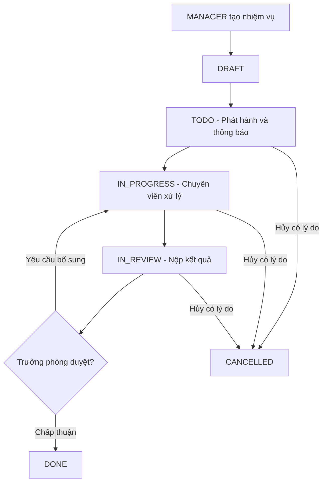
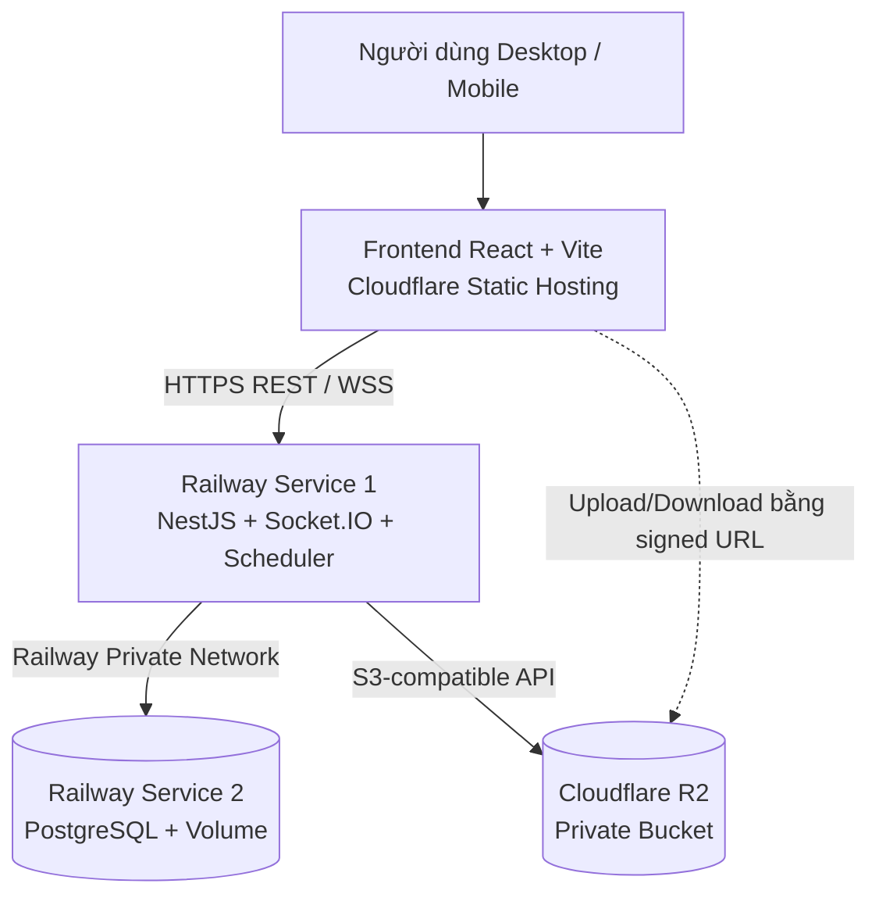

# ĐẶC TẢ TỔNG QUAN ỨNG DỤNG QUẢN LÝ CÔNG VIỆC NỘI BỘ

> **Tên dự án tạm:** Hệ thống Quản lý Công việc Nội bộ (Office Workspace)  
> **Phiên bản tài liệu:** 1.0 — 26/10/2026  
> **Quy mô ban đầu:** 11–20 thành viên trong một phòng  
> **Định hướng:** Ứng dụng web lấy cảm hứng từ Lark (Tasks/Calendar/Chat/Docs), ưu tiên điều hành công việc; không sao chép toàn bộ Lark.  
> **Kiến trúc đã chọn:** React + NestJS + PostgreSQL trên Railway + Cloudflare R2.  
> **Ngân sách mục tiêu:** khoảng **5 USD/tháng cho Railway Hobby** (backend + PostgreSQL dùng chung credit; **không cam kết** luôn nằm trong mức này).

---

## 1. Mục tiêu sản phẩm

Ứng dụng giúp một phòng chuyên môn quản lý công việc tập trung, thay cho việc giao việc rời rạc qua nhóm chat hoặc bảng tính. Mỗi công việc phải biết rõ **ai chủ trì, ai phối hợp, hạn khi nào, đang ở đâu, kết quả là gì và ai đã duyệt**.

### 1.1. Mục tiêu chính

1. Trưởng phòng giao nhiệm vụ và theo dõi toàn bộ nhiệm vụ chính thức trên một Dashboard.
2. Chuyên viên nhận việc, cập nhật tiến độ, trao đổi, nộp kết quả và xin điều chỉnh thời hạn khi cần.
3. Hệ thống cảnh báo trước hạn, quá hạn, chờ duyệt và ghi nhận lịch sử thao tác minh bạch.
4. Hỗ trợ lịch công việc, các đầu việc con, nhiệm vụ định kỳ, phối hợp nhóm, chat và đính kèm tài liệu.
5. Xuất báo cáo theo cá nhân, thời gian, trạng thái và tỷ lệ hoàn thành đúng hạn.
6. Giao diện tiếng Việt, phù hợp máy tính và điện thoại; trải nghiệm nhanh với tối đa khoảng 20 người ban đầu.

### 1.2. Phạm vi và giới hạn ban đầu

- Một phòng, một không gian làm việc (single workspace); **chưa cần multi-tenant** hoặc tổ chức nhiều cấp.
- Ba **vai trò tài khoản thực tế**: `MANAGER` (Trưởng phòng), `DEPUTY_MANAGER` (Phó phòng), và `STAFF` (Chuyên viên).
- Ba **nhóm chức năng về mặt nghiệp vụ**: Điều hành chuyên môn (Trưởng phòng & Phó phòng), Chuyên viên thực hiện, và Quản trị hệ thống (Trưởng phòng kiêm toàn bộ quản trị, **không tạo vai trò ADMIN riêng**; Phó phòng có đầy đủ quyền điều hành của Trưởng phòng nhưng không có quyền quản trị hệ thống).
- Giai đoạn đầu chỉ cần một tiến trình NestJS, một PostgreSQL trên cùng Railway project, không cần microservices/Redis.
- Không xây họp video, bộ ứng dụng văn phòng chỉnh sửa đồng thời hay bản sao toàn diện của Lark trong MVP.
- Nếu triển khai cho công việc thực tế của cơ quan nhà nước: cần có phép/đánh giá an toàn thông tin và quy định sử dụng hạ tầng trước khi đưa dữ liệu nghiệp vụ thật lên cloud; khi chưa được phê duyệt, dùng dữ liệu giả lập.

### 1.3. Thuật ngữ

| Thuật ngữ | Ý nghĩa |
|---|---|
| Nhiệm vụ chính thức | Công việc do Trưởng phòng giao, phải có người chủ trì, hạn hoàn thành và cơ chế duyệt. |
| Nhiệm vụ nhóm | Công việc hợp tác do thành viên tạo; không mặc định là chỉ đạo chính thức của Trưởng phòng. |
| Việc cá nhân | Việc tự quản lý riêng của một người, không dùng để đánh giá tiến độ công việc chính thức. |
| Chủ trì | Một người chịu trách nhiệm chính về kết quả nhiệm vụ. |
| Phối hợp | Một hoặc nhiều người tham gia hỗ trợ; không thay thế trách nhiệm của người chủ trì. |
| Người theo dõi | Người được quyền theo dõi tiến độ/thông báo mà không trực tiếp xử lý. |
| Nộp kết quả | Chủ trì gửi tài liệu, liên kết, ghi chú hoặc sản phẩm để Trưởng phòng duyệt. |
| Quá hạn | Hạn hoàn thành đã qua nhưng nhiệm vụ chưa ở trạng thái Hoàn thành hoặc Đã hủy. |

---

## 2. Vai trò và phân quyền

### 2.1. Ba vai trò tài khoản

**1. Trưởng phòng — `MANAGER` (kiêm Quản trị hệ thống)**

- Toàn quyền điều hành nghiệp vụ: tạo, giao, sửa, điều chuyển, tạm dừng, hủy và lưu trữ nhiệm vụ chính thức (`OFFICIAL`).
- Xem tất cả nhiệm vụ chính thức của cả phòng; lọc theo người, trạng thái, thời gian, dự án.
- Phê duyệt hoặc trả lại yêu cầu làm lại khi chuyên viên nộp kết quả (`/approvals`).
- Phê duyệt đề nghị gia hạn thời hạn và đề nghị thay đổi người chủ trì.
- Xem Dashboard điều hành toàn phòng, báo cáo tiến độ/khối lượng, xuất dữ liệu toàn phòng.
- Quản lý nhiệm vụ định kỳ (`/recurrence`), danh mục dự án, tài liệu và lịch công việc.
- **Toàn quyền Quản trị hệ thống (Admin)**: Tạo tài khoản, phân vai trò (`role`), khóa/mở khóa tài khoản thành viên; cấu hình không gian làm việc, múi giờ, quy tắc nhắc hạn (`/settings`); xem toàn bộ Nhật ký kiểm toán (`Audit Logs`) và xuất bản sao lưu JSON hệ thống.
- Cần có ít nhất một MANAGER hoạt động; hệ thống chặn thao tác khóa Trưởng phòng duy nhất còn lại.

**2. Phó phòng — `DEPUTY_MANAGER` (Toàn quyền Điều hành, không có quyền Quản trị)**

- **Kế thừa toàn bộ quyền điều hành chuyên môn của Trưởng phòng**:
  + Toàn quyền tạo, giao việc chính thức (`OFFICIAL`), lưu nháp và phát hành nhiệm vụ.
  + Xem tất cả nhiệm vụ chính thức của cả phòng trên Dashboard điều hành (`/dashboard`), danh sách (`/tasks`), lịch (`/calendar`), dự án (`/projects`).
  + Trực tiếp điều chỉnh nhiệm vụ chính thức (sửa hạn hoàn thành, đổi người chủ trì, mức ưu tiên, nội dung).
  + Phê duyệt (`approve`) hoặc trả lại (`return`) kết quả nộp của chuyên viên (`/approvals` và chi tiết việc).
  + Quyết định các yêu cầu gia hạn thời hạn và yêu cầu đổi người chủ trì.
  + Hủy bỏ và mở lại nhiệm vụ chính thức.
  + Quản lý cấu hình nhiệm vụ định kỳ của phòng (`/recurrence`).
  + Xem Dashboard điều hành toàn phòng với đầy đủ KPI, tiến độ, cảnh báo quá hạn.
  + Xem Báo cáo thống kê toàn phòng (`/reports`), lọc theo chuyên viên và xuất báo cáo CSV/XLSX.
  + Quản lý, xóa tệp tài liệu chung nếu cần; nhận thông báo điều hành khi chuyên viên nộp bài hoặc báo vướng mắc.
- **KHÔNG CÓ QUYỀN QUẢN TRỊ HỆ THỐNG**:
  + **Bị chặn truy cập Quản lý thành viên (`/members`)**: Không được tạo tài khoản mới, không được khóa/mở khóa tài khoản, không được thay đổi vai trò hệ thống của thành viên khác. Nếu truy cập URL trực tiếp sẽ nhận mã lỗi 403 Forbidden.
  + **Bị chặn truy cập Cài đặt hệ thống (`/settings`)**: Không được chỉnh sửa thông tin workspace, múi giờ, quy tắc nhắc hạn, không được xem Nhật ký kiểm toán hệ thống (`Audit Logs`), không được xuất bản sao lưu JSON.
  + Menu Sidebar của Phó phòng hiển thị các mục điều hành nhưng **ẩn 2 mục "Thành viên" và "Cài đặt / Nhật ký"**.

**3. Chuyên viên — `STAFF`**

- Xem công việc được giao chủ trì, phối hợp, được mời theo dõi và công việc nhóm đã tham gia.
- Tiếp nhận nhiệm vụ, cập nhật tiến độ 0-100%, đánh dấu báo vướng mắc, bình luận, đính kèm tệp kết quả.
- Nộp báo cáo kết quả hoàn thành chờ Lãnh đạo duyệt; có quyền thu hồi báo cáo khi đang ở trạng thái `IN_REVIEW` nếu chưa có quyết định phê duyệt.
- Tạo việc cá nhân (`PERSONAL`); tạo việc nhóm (`TEAM`) để phối hợp nội bộ; **không có quyền ban hành nhiệm vụ chính thức (`OFFICIAL`) thay Lãnh đạo**.
- Gửi yêu cầu gia hạn hạn nộp (`TaskDeadlineRequest`) hoặc đề nghị thay đổi người chủ trì (`TaskAssigneeRequest`) khi có lý do chính đáng.
- Xem Dashboard cá nhân, lịch cá nhân, thông báo, các cuộc trò chuyện được phép tham gia.
- Không xem toàn bộ dữ liệu nội bộ của người khác hoặc các chức năng điều hành toàn phòng / quản trị hệ thống.

### 2.2. Ma trận quyền (3 vai trò chi tiết)

| Hành động / Quyền hạn | MANAGER (Trưởng phòng kiêm QT) | DEPUTY_MANAGER (Phó phòng) | STAFF (Chuyên viên) |
|---|---|---|---|
| **Khối Điều hành Chuyên môn** | | | |
| Tạo / giao nhiệm vụ chính thức (`OFFICIAL`) | Có | Có | Không |
| Xem tất cả nhiệm vụ chính thức của phòng | Có (toàn phòng) | Có (toàn phòng) | Không (chỉ việc tham gia) |
| Xem nhiệm vụ được phân công / phối hợp | Có | Có | Có |
| Trực tiếp sửa hạn, đổi chủ trì, mức ưu tiên | Có | Có | Chỉ được gửi đề nghị |
| Phê duyệt / trả lại kết quả nộp (`IN_REVIEW`) | Có | Có | Không |
| Quyết định đề nghị xin gia hạn / đổi chủ trì | Có | Có | Không (chỉ gửi yêu cầu) |
| Hủy / mở lại nhiệm vụ chính thức | Có | Có | Không |
| Chuyển việc nhóm (`TEAM`) thành chính thức | Có | Có | Không |
| Quản lý & Thực hiện nhiệm vụ định kỳ (`/recurrence`) | CRUD & Phát hành kỳ | CRUD & Phát hành kỳ | Xem & Nộp báo cáo trực tiếp |
| Xem Dashboard điều hành & KPI toàn phòng | Có | Có | Không (Dashboard cá nhân) |
| Xem Báo cáo thống kê toàn phòng & Xuất file | Có | Có | Không (Báo cáo cá nhân) |
| Xóa / gỡ liên kết tệp tin tài liệu chung | Có | Có | Chỉ tệp do mình tải lên |
| Tạo việc cá nhân (`PERSONAL`) / việc nhóm (`TEAM`) | Có | Có | Có |
| Cập nhật tiến độ, báo vướng mắc, nộp kết quả việc mình | Có | Có | Có |
| Thu hồi báo cáo chờ duyệt (`WITHDRAWN`) | Có (khi là chủ trì) | Có (khi là chủ trì) | Có (khi là chủ trì) |
| **Khối Quản trị Hệ thống (Admin Only)** | | | |
| Truy cập màn hình Quản lý thành viên (`/members`) | Có | **Không (Chặn 403)** | **Không (Chặn 403)** |
| Tạo tài khoản thành viên mới | Có | **Không (Chặn 403)** | **Không (Chặn 403)** |
| Phân quyền / đổi vai trò tài khoản (`role`) | Có | **Không (Chặn 403)** | **Không (Chặn 403)** |
| Khóa / mở khóa tài khoản thành viên | Có | **Không (Chặn 403)** | **Không (Chặn 403)** |
| Truy cập màn hình Cài đặt hệ thống (`/settings`) | Có | **Không (Chặn 403)** | **Không (Chặn 403)** |
| Cấu hình tên phòng, múi giờ, quy tắc nhắc hạn | Có | **Không (Chặn 403)** | **Không (Chặn 403)** |
| Xem Nhật ký kiểm toán hệ thống (`Audit Logs`) | Có | **Không (Chặn 403)** | **Không (Chặn 403)** |
| Xuất bản sao lưu dữ liệu hệ thống (JSON Backup) | Có | **Không (Chặn 403)** | **Không (Chặn 403)** |

**Quy tắc kiểm soát quyền:** Phải xác thực và kiểm tra quyền ở **backend trên từng API và từng bản ghi**, không chỉ ẩn nút trên frontend. Trưởng phòng quản trị hệ thống **không mặc định được xem việc cá nhân riêng tư** trong giao diện nghiệp vụ; quyền truy cập bảo trì dữ liệu phải có kiểm soát và nhật ký.

---

## 3. Các phân hệ chức năng

### 3.1. Đăng nhập, người dùng và quản lý tài khoản (P0)

- Đăng nhập bằng tài khoản/mật khẩu; phiên đăng nhập bảo mật, đăng xuất mọi thiết bị.
- **Quản lý tài khoản (Chỉ Trưởng phòng kiêm Quản trị hệ thống)**:
  + Tạo tài khoản thành viên mới: Nhập Email công vụ (bắt buộc, đóng vai trò là tên đăng nhập duy nhất), họ tên hiển thị, số điện thoại nội bộ, tổ/bộ phận chuyên môn, chức danh công việc, vai trò hệ thống, và mật khẩu ban đầu (hoặc tự động sinh mật khẩu tạm thời ngẫu nhiên kèm chức năng sao chép).
  + Chỉnh sửa hồ sơ & điều chỉnh vai trò hệ thống (`role`): Cho phép cập nhật thông tin và chuyển đổi linh hoạt giữa `MANAGER`, `DEPUTY_MANAGER`, `STAFF` khi phân công lại nhân sự.
  + Đặt lại mật khẩu (Reset Password): Quản trị viên chủ động cấp lại mật khẩu cho thành viên (tự nhập hoặc sinh ngẫu nhiên `Ows@xxxxxx`), tự động gửi thông báo đến tài khoản đó và cho phép sao chép thông tin bàn giao.
  + Khóa / mở khóa tài khoản: Tài khoản bị khóa sẽ không thể đăng nhập hoặc lựa chọn giao việc mới, nhưng toàn bộ lịch sử phân công, báo cáo, nhật ký kiểm toán trong quá khứ được giữ nguyên vẹn.
  + Xem chi tiết hồ sơ & Tải công việc: Bảng danh sách thành viên được tối giản (không hiển thị tải công việc ở bảng); khi cần xem chi tiết tải công việc và các nhiệm vụ cụ thể, Quản trị viên bấm nút "Xem" để mở modal Chi tiết & Tải công việc.
- **Các quy tắc an toàn cốt lõi (Security Guardrails)**:
  + Cần ít nhất một `MANAGER` hoạt động; thao tác vô hiệu hóa (khóa) hoặc hạ vai trò của tài khoản Trưởng phòng hoạt động cuối cùng phải bị chặn cứng ở cả giao diện và API Backend.
  + Quản trị viên không được phép tự khóa tài khoản của chính mình (`Self-lock prevention`).
  + Phó phòng (`DEPUTY_MANAGER`) và Chuyên viên (`STAFF`) bị chặn truy cập hoàn toàn khỏi màn hình và các API quản lý tài khoản (mã lỗi 403 Forbidden).
- **Hồ sơ nhân sự**:
  + Trường thông tin: Họ tên, Email công vụ (bắt buộc, là tên đăng nhập hệ thống), ảnh đại diện, chức danh, tổ/bộ phận chuyên môn, số điện thoại nội bộ, vai trò hệ thống, trạng thái hoạt động, thời điểm tạo và thời điểm đăng nhập gần nhất (`lastLoginAt`).

### 3.2. Công việc/Nhiệm vụ (P0 — trọng tâm)

**Trường thông tin đề xuất:**

- Mã nhiệm vụ tự sinh (`CV-YYYY-0001`), tiêu đề, mô tả/đầu ra cần bàn giao.
- Loại: `OFFICIAL` (chính thức), `TEAM` (nhóm), `PERSONAL` (cá nhân).
- Người tạo, **một chủ trì**, danh sách người phối hợp, người theo dõi.
- Thời điểm giao, hạn hoàn thành (ngày/giờ), mức ưu tiên (`LOW/NORMAL/HIGH/URGENT`).
- Trạng thái, tiến độ %, nhãn, dự án/nhóm việc, liên kết nhiệm vụ cha/con.
- Ghi chú, trao đổi, lịch sử hoạt động, tệp đính kèm, sản phẩm nộp, người duyệt.
- Thời gian hoàn thành, nguồn giao (nếu cần: họp, văn bản, trực tiếp).

**Chức năng:** tạo, giao, chỉnh sửa theo quyền, sao chép nhiệm vụ, lọc/tìm kiếm/sắp xếp, đánh dấu ưu tiên, xem dạng danh sách/Kanban, thảo luận trong nhiệm vụ, nộp và duyệt kết quả. Không xóa cứng nhiệm vụ đã phát hành qua giao diện thường; dùng hủy hoặc lưu trữ.

### 3.3. Dự án/Nhóm công việc (P1)

- Gom nhiều nhiệm vụ theo một đầu việc lớn (ví dụ: tổ chức tập huấn, tổng hợp báo cáo định kỳ).
- Có tên dự án, mô tả, thời gian bắt đầu/kết thúc, người tạo, trạng thái.
- Dashboard riêng: tổng nhiệm vụ, số đã hoàn thành, số trễ, công việc quan trọng.
- Chỉ là nhóm phân loại ban đầu; không thêm cấp quản lý/phân quyền tổ chức phức tạp.

### 3.4. Lịch công việc (P1)

- Hiển thị hạn nhiệm vụ theo ngày/tuần/tháng.
- Lọc “việc của tôi”, “việc phối hợp”, “toàn phòng” (chỉ Trưởng phòng).
- Bấm vào ngày/nhiệm vụ để mở chi tiết; cảnh báo nhiệm vụ cận hạn/quá hạn.
- Nhân viên có thể xem lịch cá nhân; giai đoạn sau mới đồng bộ Google/Microsoft Calendar.

### 3.5. Thông báo và nhắc hạn (P0)

- Thông báo khi được giao nhiệm vụ, được bổ sung vào nhiệm vụ, được nhắc tên, có bình luận mới liên quan, đổi hạn, bị trả lại, được duyệt.
- Nhắc gần hạn và quá hạn theo cấu hình (chi tiết ở Mục 5).
- Chuông thông báo, số chưa đọc, danh sách thông báo và liên kết mở đúng nhiệm vụ.
- Thông báo realtime tới người đang online; người offline vẫn đọc lại từ database.
- V1 chỉ **thông báo trong app**; email/Zalo là tích hợp tùy chọn ở giai đoạn sau.

### 3.6. Chat và trao đổi (P1)

- Chat trực tiếp 1–1 và chat nhóm nội bộ, hỗ trợ gửi văn bản, emoji cơ bản, file.
- Socket.IO để cập nhật tin nhắn realtime cho người online.
- Danh sách hội thoại, tin nhắn chưa đọc, tìm kiếm tin nhắn cơ bản.
- Chỉ thành viên cuộc trò chuyện có quyền xem lịch sử và tải file liên quan.
- Trường hợp mất WebSocket: kết nối lại, lấy tin nhắn bỏ lỡ qua API; không lấy “đã gửi tới socket” làm bằng chứng đã lưu.
- **Bình luận của nhiệm vụ là kênh trao đổi theo việc**, tách với chat chung để tránh mất ngữ cảnh.
- Không xây gọi thoại/video hoặc tài liệu đồng biên tập trong P1.

### 3.7. Quản lý file Cloudflare R2 (P0)

- Cho phép tải lên tệp đính kèm nhiệm vụ, kết quả bàn giao và (P1) tệp trong chat.
- Các loại tệp chính: PDF, DOC/DOCX, XLS/XLSX, PPT/PPTX, JPG/PNG; loại khác theo danh sách cho phép.
- Mặc định giới hạn **20 MB/file** ở V1 (cấu hình được), giới hạn số file/tác vụ nếu cần.
- File lưu **Cloudflare R2 private bucket**; **không lưu bytes trong PostgreSQL**.
- PostgreSQL chỉ lưu metadata: object key, tên gốc, dung lượng, MIME, checksum, người tải, đối tượng liên kết, thời điểm tạo.
- Người dùng được cấp **URL tải lên/tải xuống có thời hạn** sau khi backend kiểm tra quyền. Không public toàn bộ bucket, không nhúng secret R2 trong frontend.
- Cần kiểm tra dung lượng/MIME thực tế sau khi upload; xử lý tệp tải dở, file không còn được tham chiếu; giai đoạn tiếp theo tích hợp quét tệp độc hại.

### 3.8. Dashboard và báo cáo (P0)

- **Trưởng phòng:** số việc theo trạng thái; quá hạn; chờ duyệt; phân bổ theo chuyên viên; tỷ lệ hoàn thành đúng hạn; các việc cần xử lý ngay.
- **Chuyên viên:** việc tôi chủ trì/phối hợp, sắp đến hạn, quá hạn, chờ duyệt và lịch trong tuần.
- Bộ lọc theo ngày/tuần/tháng/quý, người chủ trì, độ ưu tiên, dự án, trạng thái.
- Xuất CSV/XLSX; quyền xuất dữ liệu toàn phòng chỉ dành cho Trưởng phòng.
- Các báo cáo chính thức **mặc định chỉ tính nhiệm vụ `OFFICIAL`**, có thể chọn xem thêm `TEAM`; không cộng việc `PERSONAL` riêng tư vào chỉ số đánh giá.

### 3.9. Tác vụ định kỳ (P1)

- **Phân quyền & Đối tượng sử dụng**: Cả 3 vai trò (`MANAGER`, `DEPUTY_MANAGER`, `STAFF`) đều có quyền truy cập màn hình `/recurrence`.
- **Phạm vi giao việc linh hoạt**:
  + Hỗ trợ giao nhiệm vụ định kỳ cho **Cả phòng** (`scope: "ALL"`) hoặc **Nhiều chuyên viên cụ thể** (`scope: "CUSTOM"` qua danh sách `assigneeIds`).
  + Khi phát hành một kỳ mới (hàng tuần hoặc hàng tháng), hệ thống tự động sinh nhiệm vụ chính thức riêng cho từng chuyên viên trong phạm vi để mỗi người tự giác nộp báo cáo kết quả.
- **Thao tác Quản trị (Lãnh đạo: Manager & Deputy Manager)**:
  + Toàn quyền **CRUD**: Tạo mẫu định kỳ mới, Chỉnh sửa thông tin/phạm vi, Xóa mẫu định kỳ, Tạm dừng hoặc Kích hoạt lại.
  + Nút phát hành kỳ tiếp theo (`Manual Trigger`), kiểm soát chống sinh trùng lặp theo khóa duy nhất `(rule_id, period_key)`.
  + Theo dõi tiến độ nộp báo cáo của toàn bộ chuyên viên trong từng kỳ đã phát hành.
- **Báo cáo trực tiếp cho Chuyên viên (Staff)**:
  + Chuyên viên truy cập `/recurrence` để theo dõi các nhiệm vụ định kỳ được phân công.
  + Chuyên viên có thể **trực tiếp nộp báo cáo kết quả** ngay trên giao diện này thông qua modal nộp báo cáo (nhập tóm tắt kết quả, liên kết sản phẩm, ghi chú), không cần phải chuyển sang màn hình khác.
  + Sau khi nộp, nhiệm vụ chuyển sang trạng thái chờ duyệt (`IN_REVIEW`), tự động gửi thông báo đến Lãnh đạo phòng. Chuyên viên có thể xem lại báo cáo đã nộp bất kỳ lúc nào.

### 3.10. Nhật ký và cài đặt (P0)

- Audit: ai tạo/giao/sửa hạn/đổi người/duyệt/trả lại/hủy/xuất dữ liệu/quản trị tài khoản; ghi cả thời điểm và đối tượng tác động.
- Cài đặt nhắc hạn, thời gian mặc định, tên phòng, danh mục ưu tiên, quy tắc file, chính sách phiên đăng nhập.
- Tìm kiếm toàn hệ thống, workflow builder nhiều bước, AI tóm tắt: **P2/P3**, không bắt buộc với MVP.

---

## 4. Quy tắc nghiệp vụ công việc — cần triển khai nhất quán

### 4.1. Ba loại công việc

| Loại | Ai tạo? | Ai nhìn thấy? | Có phê duyệt Trưởng phòng? | Tính KPI toàn phòng? |
|---|---|---|---|---|
| `OFFICIAL` | Chỉ MANAGER | MANAGER, chủ trì, phối hợp, người được cấp xem | **Bắt buộc** | **Có** |
| `TEAM` | MANAGER/STAFF | Người tạo và người được mời/tham gia | Không mặc định; người tạo xác nhận hoàn tất | Không mặc định |
| `PERSONAL` | Chủ tài khoản | Chỉ chủ tài khoản, trừ khi chủ tài khoản chủ động chia sẻ/chuyển loại | Không | Không |

**Quy tắc quan trọng:** Chuyên viên tạo `TEAM` để **đề nghị phối hợp**, không được tự buộc thành viên khác nhận nhiệm vụ chính thức; người được mời có quyền chấp nhận/từ chối tham gia. Chuyển `TEAM` thành `OFFICIAL` phải do Trưởng phòng thực hiện.

### 4.2. Chu trình trạng thái

Các trạng thái lưu trong DB:

1. `DRAFT` — bản nháp chưa phát hành (chỉ người tạo nhìn thấy).
2. `TODO` — đã giao/chưa bắt đầu.
3. `IN_PROGRESS` — đang thực hiện.
4. `IN_REVIEW` — đã nộp kết quả, chờ người có quyền duyệt.
5. `DONE` — được xác nhận hoàn thành.
6. `CANCELLED` — đã hủy; vẫn giữ lịch sử.

Không cần trạng thái “Quá hạn” riêng: `is_overdue = due_at < now AND status NOT IN (DONE, CANCELLED, DRAFT)`. “Bị trả lại” là **một sự kiện** và chuyển trạng thái về `IN_PROGRESS`, lưu lý do; frontend có thể gắn nhãn “Yêu cầu bổ sung”. “Đang vướng mắc” là một cờ/lý do riêng (`is_blocked`, `blocked_reason`), không làm mất trạng thái tiến độ gốc.



### 4.3. Luồng giao việc chính thức

1. **Trưởng phòng tạo** nhiệm vụ với tiêu đề, nội dung, 01 người chủ trì, tùy chọn nhiều người phối hợp, hạn hoàn thành và độ ưu tiên. Có thể lưu `DRAFT`.
2. Bấm **Giao việc**: nhiệm vụ thành `TODO`; tạo sự kiện audit; phát thông báo đến chủ trì/người phối hợp.
3. **Chuyên viên chủ trì** mở nhiệm vụ, xem hướng dẫn và chọn **Bắt đầu** (`IN_PROGRESS`). Nếu vướng mắc có thể đánh dấu bị chặn, nêu lý do và bình luận.
4. Chuyên viên cập nhật tiến độ %, trao đổi, phối hợp; có thể bổ sung file minh chứng.
5. Khi xong, **chủ trì** nhập tóm tắt kết quả, đính kèm sản phẩm (nếu yêu cầu) rồi **Gửi duyệt** (`IN_REVIEW`).
6. **Trưởng phòng** xem hồ sơ, chọn:
   - **Chấp thuận:** chuyển `DONE`, ghi `completed_at`, `approved_by`, `approved_at`, khóa các trường giao việc quan trọng trừ khi mở lại có lý do.
   - **Yêu cầu bổ sung:** bắt buộc nhập lý do, ghi event, quay về `IN_PROGRESS`, thông báo cho chủ trì.
7. Mọi thay đổi hạn/người/độ ưu tiên sau khi giao phải ghi nhật ký (giá trị trước/sau).

**Quyền thao tác theo trạng thái:**

| Hành động | Điều kiện chính |
|---|---|
| Bắt đầu xử lý | Chủ trì, nhiệm vụ `TODO` |
| Cập nhật tiến độ | Chủ trì, nhiệm vụ `TODO/IN_PROGRESS` |
| Bình luận | Người được quyền truy cập, nhiệm vụ chưa bị giới hạn truy cập |
| Gửi duyệt | Chủ trì, nhiệm vụ `IN_PROGRESS`, thỏa yêu cầu đầu ra |
| Chấp thuận/trả lại | MANAGER, nhiệm vụ `IN_REVIEW` |
| Đổi hạn/chủ trì nhiệm vụ chính thức | MANAGER, ghi lý do khi đổi sau khi giao |
| Hủy nhiệm vụ chính thức | MANAGER, bắt buộc lý do |
| Mở lại nhiệm vụ `DONE` | MANAGER, bắt buộc lý do; giữ lịch sử kết quả cũ |

### 4.4. Logic việc con

- Một nhiệm vụ có thể có nhiều việc con, tối đa **2 cấp trong V1** để giao diện và thống kê không rối.
- Việc con có chủ trì, hạn, trạng thái riêng và không được quá hạn nhiệm vụ cha nếu không có xác nhận điều chỉnh từ người có quyền.
- Trạng thái nhiệm vụ cha **không tự chuyển `DONE`** chỉ vì tất cả việc con đã xong; nhiệm vụ chính thức vẫn phải nộp kết quả và được duyệt.
- % tiến độ cha có thể nhập thủ công (V1) hoặc tổng hợp từ việc con (P1); nếu tổng hợp phải công bố rõ công thức, tránh cộng trùng.

### 4.5. Logic gia hạn và thay người phụ trách

- Chuyên viên chỉ tạo **yêu cầu gia hạn** gồm hạn đề nghị + lý do; Trưởng phòng chấp thuận hoặc từ chối.
- Hạn ban đầu và lịch sử các lần gia hạn phải được bảo toàn.
- Chỉ Trưởng phòng có thể thay chủ trì nhiệm vụ chính thức; người cũ và mới nhận thông báo.
- Khi thay chủ trì, các file, bình luận và lịch sử không bị xóa; quyền truy cập của người cũ được tính lại theo việc còn là người phối hợp/theo dõi hay không.

### 4.6. Ví dụ nghiệp vụ

**Ví dụ A — Một công việc nhiều người phối hợp:**

- Trưởng phòng giao “Tổng hợp báo cáo chuyển đổi số tháng 10” cho Chuyên viên A làm **chủ trì**, Chuyên viên B/C **phối hợp**, hạn 29/10 lúc 16:30.
- A nhận thông báo, B/C nhận thông báo phối hợp. A cập nhật tiến độ, B/C bình luận và tải tài liệu lên.
- A gửi báo cáo cuối cùng, trạng thái sang `IN_REVIEW`; B/C không thể tự duyệt.
- Trưởng phòng chấp thuận → `DONE`; nếu báo cáo thiếu phụ lục → trả lại kèm lý do, A sửa và gửi lại.

**Ví dụ B — Nhiệm vụ quá hạn:**

- Hết hạn nhưng chưa `DONE` → gắn cờ quá hạn ngay trên giao diện, xuất hiện ở danh sách đôn đốc.
- Scheduler gửi nhắc quá hạn theo quy tắc; không thay đổi trạng thái nghiệp vụ thành một status mới.
- Nếu gia hạn được duyệt trước/sau hạn, hệ thống ghi lịch sử hạn cũ và cập nhật các nhắc việc chưa phát; không xóa sự kiện đã từng quá hạn.

**Ví dụ C — Việc riêng:**

- Chuyên viên tạo “Chuẩn bị tài liệu cá nhân cho cuộc họp”, chọn `PERSONAL`.
- Việc hiện trên Dashboard cá nhân nhưng **không** nằm trong bảng đôn đốc của Trưởng phòng và không tự tạo thông báo cho người khác.

---

## 5. Cron, nhắc hạn và xử lý nền

### 5.1. Thiết kế V1

- Sử dụng `@nestjs/schedule` **ngay trong service NestJS** để không phát sinh service worker/Redis riêng trên Railway.
- Mặc định kiểm tra nhắc hạn **mỗi 15 phút**; khoảng 2.880 lượt chạy/tháng 30 ngày.
- Với nhắc theo ngày, gửi vào một khung giờ hành chính đã cấu hình; hạn theo giờ xử lý chính xác theo `due_at`.
- Cron không gửi thông báo vô hạn ở mỗi lượt kiểm tra. Dùng bảng `reminder_events` và khóa duy nhất theo người nhận + nhiệm vụ + loại nhắc + mốc thời gian.
- Chỉ chạy xử lý nhắc hạn trên **một instance backend** ở V1. Nếu sau này scale nhiều instance, cần cơ chế khóa phân tán/queue; vẫn có thể dùng advisory lock PostgreSQL để phòng trùng.

### 5.2. Quy tắc nhắc hạn mặc định (cấu hình được)

| Sự kiện | Người nhận | Khi nào? |
|---|---|---|
| Nhận việc mới | Chủ trì + phối hợp | Ngay khi phát hành |
| Sắp đến hạn | Chủ trì | Trước hạn 24 giờ |
| Đến hạn | Chủ trì | Khi đến mốc hạn gần nhất mà job chạy |
| Quá hạn | Chủ trì | Nhắc ngày đầu, sau đó tối đa 1 lần/ngày cho đến khi hoàn thành/hủy/gia hạn |
| Việc quá hạn trong phòng | Trưởng phòng | Một bản tổng hợp/ngày; không spam từng lần cron |
| Có kết quả cần duyệt | Trưởng phòng | Ngay khi chuyển sang `IN_REVIEW` |
| Kết quả bị trả lại | Chủ trì | Ngay khi Trưởng phòng trả lại |
| Đổi người phụ trách/hạn | Người liên quan | Ngay khi thay đổi |

**Lưu ý:** Với hạn chỉ có ngày mà không có giờ, UI quy đổi sang giờ mặc định cấu hình theo giờ Việt Nam trước khi lưu; tránh hiểu nhầm 00:00 khiến bị đánh dấu quá hạn đầu ngày.

### 5.3. Tính đúng và chống trùng

1. Database lưu thời gian dưới dạng UTC; hiển thị theo `Asia/Ho_Chi_Minh`.
2. Cron tìm các thông báo đến hạn, tạo bản ghi trong transaction; áp dụng **unique constraint/idempotency key**.
3. Chỉ sau khi ghi DB thành công mới đẩy sự kiện Socket.IO; người offline truy vấn lại bằng API.
4. Nếu server restart khi đang chạy cron: lần chạy sau tiếp tục xử lý các mốc còn thiếu; không tạo thông báo trùng.
5. Khi nhiệm vụ đã duyệt/hủy: ngừng nhắc quá hạn. Khi đổi hạn: hủy hiệu lực các mốc nhắc chưa gửi của hạn cũ.
6. Nếu gửi qua dịch vụ ngoài ở P2, cần cơ chế retry có giới hạn và lưu kết quả gửi để tránh gửi nhiều lần.
7. Tác vụ nặng (xuất Excel lớn, quét virus, xử lý tài liệu) không thực hiện trong request lâu; tách sang hàng đợi/worker khi thật sự cần.

### 5.4. Chat realtime và chi phí nền

- Socket.IO chạy chung NestJS. Ở 20 người dùng, khởi đầu chỉ cần một instance và một WebSocket server.
- **Lưu tin nhắn PostgreSQL trước, phát sự kiện realtime sau**; phòng trường hợp người nhận mất kết nối.
- Không polling API liên tục mỗi vài giây nếu đã có socket. Giảm ping không cần thiết, phân trang lịch sử chat, không tải toàn bộ hội thoại mỗi lần vào app.
- Dùng trường `last_read_message_id` hoặc `last_read_at` theo hội thoại để tính chưa đọc.
- WebSocket giữ kết nối và RAM; **90.000 API request/tháng không phản ánh đầy đủ** tổng traffic của ứng dụng realtime.

---

## 6. Giao diện và điều hướng

### 6.1. Trưởng phòng

1. **Tổng quan** — KPIs, quá hạn, chờ duyệt, công việc quan trọng, phân bổ cá nhân.
2. **Giao việc** — tạo nhanh nhiệm vụ chính thức.
3. **Tất cả công việc** — List/Kanban, lọc, tìm, xem chi tiết.
4. **Chờ phê duyệt** — duyệt hoặc trả lại kết quả.
5. **Dự án/Nhóm việc** — danh sách nhóm công việc (P1).
6. **Lịch công việc** — tổng quan theo ngày/tuần/tháng (P1).
7. **Tin nhắn** — chat 1–1/nhóm (P1).
8. **Báo cáo** — số liệu, biểu đồ, xuất Excel.
9. **Quản lý thành viên** — tạo/khóa tài khoản, đặt lại truy cập.
10. **Cài đặt / Nhật ký** — cấu hình và audit.

### 6.2. Chuyên viên

1. **Tổng quan của tôi** — được giao, đang làm, chờ duyệt, quá hạn.
2. **Công việc của tôi** — nhiệm vụ chính thức và nhiệm vụ nhóm liên quan.
3. **Việc cá nhân** — danh sách riêng tư.
4. **Lịch của tôi** — các hạn cần xử lý.
5. **Tin nhắn** — chat cá nhân/nhóm (P1).
6. **Thông báo** — unread/read, click tới đối tượng liên quan.
7. **Hồ sơ/Cài đặt cá nhân** — đổi mật khẩu, cập nhật avatar.

### 6.3. Quy tắc UX

- Mặc định tiếng Việt; desktop ưu tiên sidebar, mobile có menu thu gọn.
- Trang danh sách có bảng, bộ lọc và phân trang; không fetch toàn bộ dữ liệu.
- Form tạo nhiệm vụ có các trường bắt buộc rõ ràng; chọn chủ trì và hạn trước khi phát hành.
- Màu thể hiện **mức ưu tiên/trạng thái** phải có chữ đi kèm, không chỉ phụ thuộc màu.
- Hành động nhạy cảm như hủy, đổi chủ trì, duyệt trả lại có xác nhận và hiển thị lý do.
- Có trạng thái loading, empty, error và cơ chế thử lại phù hợp.

---

## 7. Dashboard và công thức thống kê

**Chỉ tiêu mặc định của Dashboard Trưởng phòng:**

- **Tổng việc chính thức:** số nhiệm vụ `OFFICIAL` đã phát hành trong bộ lọc, không bao gồm bản nháp/hủy (số hủy hiển thị riêng).
- **Chưa làm:** `TODO`.
- **Đang làm:** `IN_PROGRESS`.
- **Chờ duyệt:** `IN_REVIEW`.
- **Đã hoàn thành:** `DONE`.
- **Quá hạn hiện tại:** `due_at < now()` và chưa `DONE/CANCELLED/DRAFT`.
- **Hoàn thành đúng hạn:** `completed_at <= due_at` ở thời điểm duyệt hoàn thành; có thể lưu snapshot hạn tại thời điểm hoàn thành để kiểm tra các lần gia hạn.
- **Tỷ lệ hoàn thành:** `DONE / tổng nhiệm vụ chính thức hợp lệ` trong phạm vi lọc; tránh dùng mẫu số khác nhau giữa biểu đồ.
- **Công việc chờ duyệt lâu:** thời gian từ `submitted_at` đến hiện tại, xếp giảm dần.
- **Theo cá nhân:** số việc **chủ trì**; người phối hợp được tính ở thống kê riêng để tránh một nhiệm vụ bị cộng nhiều lần.

**Báo cáo:** tổng quan theo thời gian; bảng từng chuyên viên; danh sách quá hạn; tỷ lệ đúng hạn; danh sách chờ duyệt; nhật ký giao/đổi hạn/duyệt. Có lọc và xuất XLSX. Trong file xuất cần ghi thời điểm xuất, người xuất, bộ lọc đã sử dụng.

---

## 8. Kiến trúc kỹ thuật đã chọn



| Tầng | Lựa chọn | Ghi chú |
|---|---|---|
| Frontend | React, TypeScript, Vite | SPA responsive, deploy Cloudflare |
| UI | Tailwind CSS + shadcn/ui | Giao diện quản trị/công việc |
| Backend | NestJS, TypeScript | Modular monolith; REST + WebSocket |
| ORM | Prisma hoặc Drizzle | Chọn **một**, không phối hợp hai ORM tùy tiện; ưu tiên Prisma nếu cần phát triển CRUD nhanh |
| Database | PostgreSQL | Cùng Railway project, private networking, volume bền vững |
| Realtime | Socket.IO | Một backend instance ở V1 |
| Scheduler | `@nestjs/schedule` | Chạy trong backend, cron 15 phút |
| File | Cloudflare R2 | Bucket private, signed URL, lưu metadata trong PostgreSQL |
| Auth | Cookie/session bảo mật hoặc access/refresh token | Chốt một cơ chế; backend áp dụng RBAC + kiểm tra object-level |
| Báo cáo | ExcelJS + Recharts | Excel server-side, biểu đồ frontend |
| CI/CD | GitHub → Railway/Cloudflare | Staging trước production nếu có ngân sách |

**Không dùng Redis, Kafka, Kubernetes, microservices ở MVP.** Chỉ bổ sung khi số lượng người dùng, số backend instance hoặc nhu cầu xử lý nền thực tế tăng.

### 8.1. Module NestJS đề xuất

```text
src/
├── auth/
├── users/
├── workspaces/          # cấu hình một phòng, không multi-tenant
├── projects/
├── tasks/
│   ├── assignments/
│   ├── submissions/
│   ├── approvals/
│   ├── comments/
│   └── recurrence/
├── notifications/
├── reminders/
├── chat/
├── files/
├── reports/
├── audit/
├── common/              # guards, interceptors, errors, pagination
└── app.module.ts
```

### 8.2. Lưu file R2 an toàn

1. FE gửi yêu cầu `POST /files/upload-url` gồm `filename`, `size`, `contentType`, `entityType`, `entityId`.
2. BE kiểm tra đăng nhập, vai trò, quyền đối với nhiệm vụ/hội thoại, loại tệp, dung lượng.
3. BE sinh object key ngẫu nhiên, cấp signed PUT URL sống ngắn (ví dụ 5 phút).
4. FE upload trực tiếp tới R2, tránh file lớn đi qua RAM/egress Railway.
5. FE gọi `POST /files/complete`; BE xác minh đối tượng R2 (HEAD/metadata), ghi metadata vào PostgreSQL.
6. Khi tải file, BE xác thực quyền và cấp signed GET URL có hạn dùng ngắn; không cho liệt kê object trong bucket.
7. Xóa liên kết tệp bằng soft delete trước; dọn object rác qua tác vụ định kỳ có kiểm soát.

---

## 9. Mô hình dữ liệu PostgreSQL (khung thiết kế)

> Đây là mô hình logic để triển khai migration; tên cột/trường có thể thay đổi khi viết Prisma schema. Mọi bảng nghiệp vụ nên có `id`, `created_at`, `updated_at` phù hợp.

| Bảng | Nội dung chính |
|---|---|
| `users` | Tài khoản, tên, mật khẩu hash, role, trạng thái, thông tin hồ sơ |
| `auth_sessions` | Phiên đăng nhập/refresh token đã hash, hết hạn, thu hồi |
| `projects` | Nhóm/dự án công việc, mô tả, trạng thái |
| `tasks` | Loại việc, tiêu đề, mô tả, status, priority, owner, primary assignee, hạn, %, parent, project, kết quả |
| `task_participants` | `task_id`, `user_id`, `participant_role` (`COLLABORATOR/WATCHER`), trạng thái lời mời nhóm |
| `task_comments` | Bình luận trong nhiệm vụ, người viết, nội dung, thời điểm |
| `task_submissions` | Mỗi lần chủ trì gửi kết quả: tóm tắt, thời điểm, người gửi |
| `task_approvals` | Kết quả duyệt/trả lại, người duyệt, lý do, thời điểm, liên kết submission |
| `task_deadline_requests` | Yêu cầu gia hạn, thời hạn đề xuất, lý do, quyết định |
| `task_events` | Dòng thời gian thay đổi trạng thái, chủ trì, hạn, ưu tiên, tiến độ |
| `recurrence_rules` | Quy tắc tạo nhiệm vụ định kỳ, mẫu nhiệm vụ, kỳ tiếp theo |
| `notifications` | Thông báo lưu bền, người nhận, loại, đối tượng, thời điểm đọc |
| `reminder_events` | Mốc nhắc đã tạo/gửi, chống trùng cron |
| `chat_rooms` | Hội thoại 1–1/nhóm |
| `chat_room_members` | Người tham gia, vai trò trong nhóm chat, mốc đã đọc |
| `chat_messages` | Nội dung tin nhắn, người gửi, thời điểm, trạng thái chỉnh sửa/xóa mềm |
| `file_objects` | Metadata file R2, object key, checksum, kích thước, người upload |
| `file_links` | Liên kết file với task/submission/comment/message |
| `audit_logs` | Nhật ký quyền, thao tác quản trị, các thay đổi nhạy cảm |
| `app_settings` | Cấu hình chung, cài đặt nhắc hạn, giới hạn file |

**Ràng buộc/index quan trọng:**

- `users.email_or_username` duy nhất; không lưu mật khẩu thô.
- `tasks.primary_assignee_id` bắt buộc khi phát hành việc `OFFICIAL`.
- `task_participants` unique (`task_id`, `user_id`, `participant_role`), tránh bản ghi trùng.
- Chỉ mục cho `tasks(status, due_at)`, `tasks(primary_assignee_id, status, due_at)`, `tasks(project_id, status)`.
- Chỉ mục `notifications(recipient_id, read_at, created_at DESC)`, `chat_messages(room_id, created_at DESC)`.
- `reminder_events` unique (`task_id`, `recipient_id`, `reminder_type`, `milestone_key`), bảo đảm idempotent.
- `recurrence_instances` hoặc một trường khóa duy nhất theo (`rule_id`, `period_key`) để không tạo nhiệm vụ định kỳ hai lần.
- Có chiến lược soft-delete rõ ràng, khóa ngoại hợp lệ và transaction cho mỗi thao tác nhiều bước.

---

## 10. Khung API (dự kiến)

### Auth và user

```http
POST   /api/auth/login
POST   /api/auth/logout
POST   /api/auth/refresh
GET    /api/auth/me
GET    /api/users
POST   /api/users                    # MANAGER
PATCH  /api/users/:id                # MANAGER; STAFF chỉ sửa hồ sơ của mình qua /me
PATCH  /api/users/:id/status         # MANAGER
```

### Task / công việc

```http
GET    /api/tasks                    # lọc theo role, scope, status, date, assignee
POST   /api/tasks                    # STAFF chỉ TEAM/PERSONAL, MANAGER tạo OFFICIAL
GET    /api/tasks/:id
PATCH  /api/tasks/:id
POST   /api/tasks/:id/publish        # MANAGER, OFFICIAL
POST   /api/tasks/:id/start          # người chủ trì
POST   /api/tasks/:id/progress       # người chủ trì
POST   /api/tasks/:id/submit         # người chủ trì, gửi kết quả
POST   /api/tasks/:id/approve        # MANAGER, OFFICIAL
POST   /api/tasks/:id/return         # MANAGER, OFFICIAL; bắt buộc lý do
POST   /api/tasks/:id/cancel         # MANAGER, OFFICIAL; bắt buộc lý do
POST   /api/tasks/:id/deadline-requests
POST   /api/tasks/:id/comments
GET    /api/tasks/:id/events
```

### Báo cáo, thông báo, chat và file

```http
GET    /api/dashboard
GET    /api/reports/tasks
GET    /api/reports/tasks/export
GET    /api/notifications
POST   /api/notifications/:id/read
GET    /api/chat/rooms
GET    /api/chat/rooms/:id/messages
POST   /api/chat/rooms/:id/messages
POST   /api/files/upload-url
POST   /api/files/complete
GET    /api/files/:id/download-url
```

**Lưu ý:** Cần version API nếu phát triển lâu dài (`/api/v1/...`); không để client gửi/ghi đè các trường nhạy cảm như `approved_by`, `created_by`, `role` hay `completed_at`. Backend tự suy ra các trường đó từ phiên đăng nhập và nghiệp vụ.

### Socket.IO events (P1)

```text
client -> server: room:join, message:send, notification:ack
server -> client: message:new, message:updated, notification:new, task:updated
```

Mọi sự kiện phải xác thực và kiểm tra quyền phòng chat/nhiệm vụ. Không tin room ID do client cung cấp mà chưa kiểm tra membership.

---

## 11. Bảo mật, quyền riêng tư và vận hành

### 11.1. Yêu cầu tối thiểu

- HTTPS/TLS cho mọi kết nối, cookie `HttpOnly + Secure + SameSite` nếu dùng session cookie.
- Password hash Argon2id/bcrypt với thông số phù hợp; không bao giờ ghi mật khẩu/token vào log.
- Chặn brute-force, giới hạn request đăng nhập; validate toàn bộ input (DTO/validation pipes).
- RBAC **kết hợp kiểm tra quyền cấp bản ghi**: người không tham gia nhiệm vụ/hội thoại không được đọc bằng cách đoán URL/ID.
- File R2 private, signed URL thời hạn ngắn; xác thực loại file và kích thước; không dùng tên file gốc làm R2 key.
- Nhật ký hệ thống cho đăng nhập, giao việc, đổi hạn, duyệt, hủy, thay quyền và truy cập dữ liệu nhạy cảm theo chính sách.
- Không cho tự chỉnh role, tự duyệt kết quả chính thức hoặc thay đổi lịch sử thao tác bằng API.
- Bí mật `DATABASE_URL`, `R2_ACCESS_KEY_ID`, `R2_SECRET_ACCESS_KEY`, khóa ký phiên nằm trong Railway Variables; không commit `.env`.
- CORS chỉ cho phép domain FE; giới hạn payload và timeout hợp lý.

### 11.2. Dữ liệu và sao lưu

- PostgreSQL dùng volume bền vững trên Railway; **volume không thay thế backup**.
- Thiết lập backup/`pg_dump` độc lập, kiểm tra khôi phục theo lịch; chi phí backup có thể phát sinh và cần tính riêng.
- Trước migration có thay đổi phá vỡ dữ liệu phải có bản sao lưu và kế hoạch rollback.
- Tệp R2 và database phải có chiến lược sao lưu/khôi phục nhất quán; tránh database trỏ tới file đã mất.
- Có chính sách lưu giữ/xóa dữ liệu, tài khoản nghỉ việc, thu hồi phiên và quyền với tệp.
- Nếu dùng trong cơ quan nhà nước, rà soát yêu cầu pháp lý, phân loại dữ liệu, lưu trữ/xử lý ở nước ngoài và phê duyệt bảo mật trước triển khai chính thức.

### 11.3. Quản lý truy cập MANAGER

- Trưởng phòng chính là tài khoản quản trị cao nhất, không tạo một ADMIN công khai riêng.
- Không cho xóa/khóa MANAGER duy nhất qua UI.
- Chuẩn bị quy trình khôi phục quyền quản trị bằng thao tác vận hành có xác thực, được ghi log, không mở sẵn backdoor.
- Khuyến nghị MFA với tài khoản Trưởng phòng khi chuyển từ môi trường thử nghiệm sang vận hành thật.

---

## 12. Triển khai Railway và dự toán hạ tầng

| Thành phần | Vị trí | Dự toán/ghi chú |
|---|---|---|
| NestJS API + Socket.IO + Scheduler | Railway Hobby | Dùng chung credit $5 với database |
| PostgreSQL + Volume | Railway, private network | Phải tính RAM, CPU, volume, backup |
| React SPA | Cloudflare Pages/Static Assets | Miễn phí trong hạn mức |
| Files | Cloudflare R2 | Miễn phí trong hạn mức; phí khi vượt |
| Domain | Domain sẵn có hoặc mua riêng | Không tính trong $5 |

**Mức tải ban đầu giả định:** 20 người × 10 lượt/ngày × 15 API request/lượt × 30 ngày = **90.000 API request/tháng**. Đây là con số để dự toán, chưa tính WebSocket, upload/download, scheduler, tự động đồng bộ hoặc request phát sinh khác.

**Lưu ý ngân sách:** Railway Hobby có **mức tối thiểu khoảng $5/tháng**, bao gồm mức credit sử dụng theo giá tại thời điểm lập kế hoạch; nếu tổng tài nguyên cao hơn thì trả thêm. Chạy cả NestJS và PostgreSQL ở $5 **chỉ là mục tiêu tối ưu**, không đảm bảo. RAM thường trực của hai tiến trình thường quan trọng hơn tổng API request. Kiểm tra bảng giá Railway tại thời điểm triển khai thực tế.

### 12.1. Nguyên tắc tiết kiệm tài nguyên

1. Chỉ dùng **một** NestJS service và **một** PostgreSQL service ở V1.
2. Cron chạy trong NestJS mỗi 15 phút, xử lý theo batch, index tốt; không thêm worker riêng.
3. Upload/download file trực tiếp R2 bằng signed URL để giảm RAM và egress qua Railway.
4. Danh sách công việc và chat phân trang; bộ lọc chạy phía server.
5. Không polling nhiệm vụ/tin nhắn quá thường xuyên; tận dụng Socket.IO cho sự kiện realtime.
6. Giới hạn truy vấn DB, kích cỡ connection pool và số kết nối WebSocket hợp lý.
7. Theo dõi Railway Metrics (RAM/CPU/network), thời gian truy vấn, lỗi và ước tính hóa đơn theo tuần.
8. Đưa vào staging bằng dữ liệu mẫu, mô phỏng 20–50 người và kiểm tra khả năng chịu tải trước khi kết luận $5 là đủ.

### 12.2. Cấu hình biến môi trường dự kiến

```env
NODE_ENV=production
PORT=3000
DATABASE_URL=postgresql://...@...railway.internal:5432/...
APP_URL=https://app.example.com
CORS_ORIGIN=https://app.example.com
SESSION_SECRET=<secret-generated-securely>
R2_ACCOUNT_ID=<cloudflare-account-id>
R2_BUCKET=<private-bucket-name>
R2_ACCESS_KEY_ID=<secret>
R2_SECRET_ACCESS_KEY=<secret>
APP_TIMEZONE=Asia/Ho_Chi_Minh
CRON_REMINDER=0 */15 * * * *
```

Chỉ là mẫu khóa cấu hình, **không** dùng giá trị placeholder trong production. Cần đối chiếu định dạng cron cụ thể của `@nestjs/schedule` và thiết kế phiên đăng nhập trước khi code.

---

## 13. Lộ trình phát triển ưu tiên

### P0 — MVP: hệ thống giao việc sử dụng được

- [ ] Thiết lập monorepo hoặc hai repository rõ ràng; CI/CD, env, logging, migration.
- [ ] Đăng nhập, phiên, hai role, CRUD tài khoản cho Trưởng phòng.
- [ ] Giao nhiệm vụ chính thức, chủ trì + phối hợp, deadline/priority/status.
- [ ] Danh sách công việc, chi tiết, bình luận, Kanban cơ bản.
- [ ] Cập nhật tiến độ, gửi kết quả, Trưởng phòng duyệt/trả lại.
- [ ] R2 private uploads và tải file có kiểm tra quyền.
- [ ] Dashboard cá nhân/toàn phòng, bộ lọc, báo cáo XLSX cơ bản.
- [ ] Thông báo trong app + cron nhắc trước hạn/quá hạn có chống trùng.
- [ ] Audit log, validation, rate-limit đăng nhập, backup/restore thử nghiệm.

### P1 — Cộng tác kiểu Lark thu nhỏ

- [ ] Chat 1–1, chat nhóm qua Socket.IO; tin nhắn chưa đọc, tệp đính kèm.
- [ ] Lịch ngày/tuần/tháng; dự án và nhóm công việc.
- [ ] Việc con, template và nhiệm vụ định kỳ; đề nghị gia hạn.
- [ ] Tìm kiếm và bộ lọc nâng cao; dashboard theo từng dự án.
- [ ] Giao diện mobile/PWA, thông báo realtime tốt hơn.

### P2 — Nâng cao khi thực sự cần

- [ ] Workflow/phê duyệt nhiều bước có cấu hình.
- [ ] Bảng dữ liệu tùy biến kiểu Lark Base, Gantt và phụ thuộc nhiệm vụ.
- [ ] Tích hợp thông báo email/Zalo hợp lệ.
- [ ] Soạn thảo tài liệu trực tuyến/cộng tác; chỉ triển khai khi đã chọn giải pháp đồng bộ thích hợp.
- [ ] AI tóm tắt công việc, báo cáo; cần xem chi phí và chính sách dữ liệu.
- [ ] Redis/queue/worker riêng hoặc scale ngang khi quan sát được nhu cầu thật.

---

## 14. Tiêu chí nghiệm thu bắt buộc

### Quyền và an toàn

- [ ] STAFF gọi trực tiếp API của MANAGER bị từ chối, kể cả khi frontend đã ẩn nút.
- [ ] STAFF A không đọc được nhiệm vụ/chat/file riêng của STAFF B nếu không được cấp quyền.
- [ ] MANAGER kiêm quản trị, không có role `ADMIN` thứ ba trong database.
- [ ] Không upload/tải được file R2 khi thiếu quyền; URL ký hết hạn không còn hợp lệ.

### Nghiệp vụ

- [ ] Một nhiệm vụ chính thức có đúng một người chủ trì và có thể có nhiều người phối hợp.
- [ ] STAFF không được tự đổi hạn/người chủ trì của nhiệm vụ chính thức.
- [ ] Chủ trì nộp kết quả → Trưởng phòng nhận thông báo → duyệt hoặc trả lại kèm lý do.
- [ ] Việc bị trả lại có thể nộp lại, đầy đủ lịch sử lần nộp và lần duyệt.
- [ ] Việc `DONE`/`CANCELLED` không bị nhắc quá hạn.
- [ ] Job chạy lại/restart không tạo nhắc hạn hoặc nhiệm vụ định kỳ trùng.
- [ ] Dashboard phân biệt việc chính thức, nhóm và cá nhân; số liệu không cộng trùng người phối hợp.

### Kỹ thuật

- [ ] 20 người có thể sử dụng bình thường; kiểm thử đồng thời tối thiểu theo kịch bản đã định.
- [ ] Backend và PostgreSQL giao tiếp qua kết nối nội bộ Railway.
- [ ] Socket mất kết nối rồi nối lại vẫn lấy đúng tin nhắn/thông báo bỏ lỡ.
- [ ] Upload tệp lớn không đi qua bộ nhớ backend; lỗi upload không tạo metadata “hoàn tất” giả.
- [ ] Metrics, error logs, backup và thử khôi phục được kiểm chứng trước khi sử dụng thật.

---

## 15. Các quyết định đã chốt và các giả định có thể điều chỉnh

### Đã chốt

- Quy mô giai đoạn đầu **11–20 người**.
- **Hai vai trò tài khoản:** Trưởng phòng (`MANAGER`) và Chuyên viên (`STAFF`); quản trị hệ thống nằm trong Trưởng phòng.
- **Railway** chạy NestJS backend và PostgreSQL trong cùng dự án, mục tiêu **$5/tháng** nếu tiêu thụ tài nguyên phù hợp.
- **Cloudflare R2** là nơi lưu tệp đính kèm (không lưu trong PostgreSQL).
- Ứng dụng ưu tiên quản lý công việc, có hướng mở rộng cộng tác kiểu Lark.

### Mặc định đề xuất để lập trình (có thể thay đổi)

- Chuyên viên có việc cá nhân và việc nhóm, nhưng chỉ Trưởng phòng giao nhiệm vụ chính thức.
- Nhiệm vụ chính thức buộc phải được Trưởng phòng duyệt mới được tính hoàn thành.
- Chat realtime và dự án được triển khai sau phần giao việc MVP.
- Cron nhắc hạn mỗi 15 phút; trước hạn 24 giờ và quá hạn tối đa một lần/ngày.
- Giới hạn 20 MB/file ở bản đầu; R2 private, signed URL ngắn hạn.
- Một backend instance, chưa cần Redis hay microservice.
- Dữ liệu hiển thị giờ Việt Nam; thời điểm lưu trong PostgreSQL ở UTC.

### Các điều cần kiểm tra khi thử nghiệm

- Mức RAM trung bình thực tế của NestJS và PostgreSQL trên Railway; hóa đơn có duy trì được $5 không.
- Phạm vi, chu kỳ và thời điểm nhắc hạn phù hợp giờ làm việc của phòng.
- Quyền xem việc nhóm/việc cá nhân, cách phê duyệt trong những trường hợp ngoại lệ.
- Dung lượng file và chính sách lưu giữ/sao lưu phù hợp yêu cầu của đơn vị.

---

## 16. Chỉ dẫn sử dụng tài liệu này với Antigravity / Codex

1. Dùng tài liệu này làm **nguồn yêu cầu sản phẩm (PRD) và nghiệp vụ gốc**.
2. Yêu cầu công cụ tạo kế hoạch triển khai theo thứ tự **schema → auth/RBAC → task lifecycle → notifications/cron → R2 → dashboard → chat**.
3. Không tự thêm vai trò mới, không tự đổi luồng phê duyệt, không tự chuyển kho file khỏi Cloudflare R2 khi chưa được yêu cầu.
4. Mỗi module phải có migration, validation, test phân quyền và các ca biên tương ứng.
5. Khi phát hiện mâu thuẫn giữa trải nghiệm UI và bảo mật, ưu tiên **kiểm tra quyền server-side**.
6. Trước khi thay đổi logic quan trọng, nêu quyết định kỹ thuật và ảnh hưởng tới dữ liệu/chi phí.
7. Chỉ coi một tính năng hoàn tất khi cả API, giao diện, test, logging và các trạng thái lỗi chính đều hoạt động.

**Tóm tắt một câu:** Xây dựng một hệ thống giao việc và phối hợp nội bộ gọn nhẹ cho 11–20 người, với Trưởng phòng kiêm quản trị, Chuyên viên là người thực hiện, quy trình giao–làm–nộp–duyệt–nhắc hạn minh bạch, backend NestJS + PostgreSQL trên Railway và tệp đính kèm trên Cloudflare R2.
