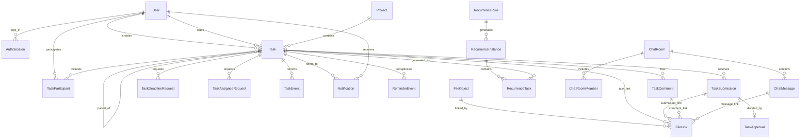

# BE-00-04 — Dữ liệu, migration và fixture clock cố định

**Nguồn:** D-04/D-06/D-08/D-09/D-10 tại [Phase 00](../PHASE_00_CONTRACT.md), đặc tả §7/§9, handoff §3/§4/§5/§9, FE `data-contract.ts`, `mock-seed.ts`, `task-selectors.ts`. [Fixture chuẩn](./kpi-fixture.v1.json) sinh lại bằng `build_fixture.py`; các alias `u01`/`t01` chỉ dùng trong tài liệu/seed, API và DB dùng UUID do server sinh.

## ERD logic

`FileLink` đa hình không thể dùng một FK `entityId` tới bốn bảng. Migration tạo `file_links` với đúng một trong `task_id`, `submission_id`, `comment_id`, `message_id` (CHECK exactly one non-NULL), mỗi cột là FK thật. API vẫn trả `entityType/entityId`. Tương tự notification dùng `task_id` hoặc `chat_room_id` có CHECK, không FK đa hình mơ hồ. P0 chỉ TASK/SUBMISSION/COMMENT; MESSAGE và chat thêm ở P1. Tệp upload trước nộp có một `TASK` link tạm; transaction submit kiểm tra READY/quyền, tạo `SUBMISSION` link và gỡ link tạm. Mỗi file chỉ có một link còn hiệu lực tại một thời điểm; link cũ giữ để audit. `REMOVED` chặn URL mới ngay; object chỉ xóa sau 90 ngày khi không còn link hợp lệ hoặc có chính sách lưu lâu hơn.

## Bảng, khóa và ràng buộc Prisma/PostgreSQL

| Bảng/model | Trường và ràng buộc cốt lõi | Index/unique |
|---|---|---|
| `users`/`User` | `id UUID`, email công vụ lưu dạng canonical lower-case, role 3 giá trị, status ACTIVE/LOCKED, passwordHash, createdAt/updatedAt | Unique `lower(email)` qua migration SQL; index role/status |
| `auth_sessions` | UUID, user FK RESTRICT, hash refresh token, `expiresAt`, `revokedAt`, `rotatedFromId`, device metadata an toàn | Unique token hash; index `(userId, revokedAt, expiresAt)` |
| `app_settings` | Singleton row, timezone cố định Asia/Ho_Chi_Minh, `defaultDueHour=16`, reminderBeforeHours=24, maxFileSizeMb=20 | CHECK hour 0–23, positive limits |
| `business_code_counters` | `(prefix, year)` → `nextValue`; prefix CV/NH/CN; năm theo Asia/Ho_Chi_Minh ở thời điểm tạo | PK `(prefix, year)`; cấp số trong transaction bằng UPSERT `RETURNING`/row lock |
| `projects` (P0 FK placeholder; API P1) | UUID, owner FK, status ACTIVE/ARCHIVED, timestamps | index owner/status |
| `tasks` | UUID, `code`, type/status/priority, creator FK, nullable assignee khi DRAFT, project/parent FK, dueAt TIMESTAMPTZ, `completedAt`, `completionDueAtSnapshot`, `approvedById`, `version`; CHECK progress 0–100, `isBlocked ⇒ blockedReason`, OFFICIAL đã publish ⇒ assignee và dueAt | Unique code; `(type,status,dueAt)`, `(primaryAssigneeId,status,dueAt)`, `(projectId,status)`, `(parentTaskId)`, `(createdById,status)` |
| `task_participants` | UUID, task/user FK, role, invitation status, invited/responded timestamps | Unique `(taskId,userId,role)`; index user/status |
| `task_comments` | UUID, task/author FK, body nonempty, created/edited | `(taskId,createdAt,id)` |
| `task_submissions` | UUID, task/submitter FK, status PENDING/APPROVED/RETURNED/WITHDRAWN, content, submitted/withdrawn | `(taskId,submittedAt,id)`; partial unique one PENDING/task |
| `task_approvals` | UUID, task/submission/decider FK, decision, reason, decidedAt, `dueAtSnapshot`; reason required RETURNED | Unique `submissionId`; `(taskId,decidedAt,id)` |
| `task_deadline_requests`, `task_assignee_requests` (P1 API) | UUID, task/requester/decider FK, proposal, reason, status, decision time/reason | Partial unique one PENDING per task per request kind; `(taskId,createdAt,id)` |
| `task_events` | UUID, task/actor FK, kind, note, before/after JSONB, createdAt; append-only | `(taskId,createdAt,id)`; no update/delete API |
| `notifications` | UUID, recipient FK, task/chat FK, type, title/body, readAt, businessEventId | Unique `(businessEventId,recipientId)`; `(recipientId,readAt,createdAt,id)` |
| `reminder_events` | UUID, task/recipient FK, type, milestoneKey, createdAt | Unique `(taskId,recipientId,reminderType,milestoneKey)` |
| `file_objects`, `file_links` | File UUID, objectKey server-only unique, uploader FK, status UPLOADING/READY/REMOVED, size/MIME/checksum, `removedAt`; link có đúng một FK entity và `removedAt` để giữ lịch sử | Unique objectKey; `(uploadedById,status)`, FK link, partial unique một link active/file và unique `(fileId,entity)` từng loại |
| `audit_logs` | UUID, actor nullable, action/entity, before/after redacted JSONB, createdAt; append-only | `(createdAt,id)`, `(actorId,createdAt)` |
| P1: `recurrence_rules`, `recurrence_rule_assignees`, `recurrence_instances`, `recurrence_tasks` | Rule/assignee/instance/task có FK; `periodKey`; kỳ cũ giữ khi rule tắt | Unique `(ruleId,periodKey)` và `(instanceId,taskId)` |
| P1: `chat_rooms`, `chat_room_members`, `chat_messages` | Room/member/message FK; lastReadAt; edit/delete soft | Unique `(roomId,userId)`; `(roomId,createdAt,id)` |

Prisma schema dùng `@db.Uuid`, `@db.Timestamptz(3)`, enum, `@relation`/`@@index`/`@@unique` cho phần thể hiện được. Migration SQL bổ sung `lower(email)` unique, partial unique PENDING, CHECK đa hình file link và CHECK nghiệp vụ; ghi chúng rõ trong migration vì Prisma schema không thay thế toàn bộ ràng buộc PostgreSQL. FK lịch sử dùng RESTRICT/soft delete để không mất submission/approval/event. `Task.version` tăng trong mỗi command; update có điều kiện version hoặc khóa hàng, trả 409 khi race.

### Cấp mã nghiệp vụ nguyên tử

Trong cùng transaction tạo task: xác định năm Việt Nam tại clock server; UPSERT counter `(prefix,year)` và nhận một sequence duy nhất qua `INSERT ... ON CONFLICT ... DO UPDATE ... RETURNING`; format `CV-YYYY-0001`, `NH-...`, `CN-...`; insert task với unique `code`. Mã không tái sử dụng sau xóa/hủy. Chuyển TEAM → OFFICIAL cấp CV mới và ghi mã NH cũ trong `TaskEvent.TYPE_CHANGED`. Không tính `MAX(code)+1` ngoài transaction.

### Thứ tự migration

1. Phase 01: enum; users/auth_sessions/settings/counter; projects placeholder; tasks và FK user/project/parent; participants/comments/submissions/approvals/requests/events; notifications/reminder_events; files/file_links; audit_logs; index/CHECK/partial unique. Tạo FK chu kỳ nếu có thể trì hoãn sang P1.
2. Phase 05: nếu cần, bổ sung cột checksum/verification, index cleanup và trạng thái file; không làm mất dữ liệu UPLOADING cũ.
3. Phase 09: recurrence và chat, `message_id` link, migration backfill có khóa; seed t14–t17. Chạy migration trên DB rỗng và bản trước, lưu rollback/restore plan.

## Quy ước thời gian và KPI

- DB dùng TIMESTAMPTZ; API request/response dùng UTC `Z`. UI định dạng `Asia/Ho_Chi_Minh`. `dueDate=2026-11-15` cùng `defaultDueHour=16` thành `2026-11-15T09:00:00.000Z`. Không dùng ngày local implicit của server. Khi cả `dueAt` và `dueDate` có mặt, trả 400.
- `Task.dueAt` là hạn hiện tại. Khi phê duyệt DONE, lưu `dueAtSnapshot` trên approval và `completionDueAtSnapshot` trên Task. KPI đúng hạn dùng snapshot của approval hoàn thành hiện hành: `completedAt <= completionDueAtSnapshot`. Khi mở lại DONE, reset completedAt/snapshot hiện hành nhưng giữ approval/submission cũ. Sau gia hạn, quyết định APPROVED mới đổi `dueAt` và tạo event before/after.
- Khi hủy task đang IN_REVIEW, submission PENDING hiện hành được đánh dấu WITHDRAWN kèm lý do hệ thống trong cùng transaction; bản ghi vẫn tồn tại để truy vết. Lúc mở lại, không có PENDING cũ ngăn lần nộp mới. Nếu task bị hủy từ DRAFT rồi mở lại, validate đủ điều kiện publish trước khi chuyển TODO.
- KPI phòng mặc định: `type=OFFICIAL AND status NOT IN (DRAFT,CANCELLED)`. `totalActivePublished` là tổng TODO+IN_PROGRESS+IN_REVIEW+DONE. `overdueCount`: dueAt < injected clock, status TODO/IN_PROGRESS/IN_REVIEW. `completedOnTimeCount`: DONE và completedAt <= snapshot. `draftCount/cancelledCount` đếm riêng; `totalOfficialCount` gồm cả hai. Theo người, `primaryCount` đếm OFFICIAL hợp lệ theo `primaryAssigneeId` một lần; collaborator/watcher tách riêng. ACL lọc trước KPI cá nhân, project/calendar/file/export.
- Fixture dùng clock `2026-10-27T09:00:00.000Z`, tương ứng 16:00 Việt Nam, sinh từ offsets FE một lần và lưu timestamp tuyệt đối trong [`kpi-fixture.v1.json`](./kpi-fixture.v1.json). Seed BE dùng clock injected hoặc đọc timestamp tuyệt đối, không lấy `new Date()` để dịch dữ liệu theo ngày chạy. Fixture alias là khóa idempotency, DB ID thật là UUID server sinh khi insert đầu tiên; lần seed sau upsert bằng email/code/periodKey.

| Bộ fixture | OFFICIAL tổng | Hợp lệ | TODO | IN_PROGRESS | IN_REVIEW | DONE | Quá hạn | Đúng hạn | DRAFT | CANCELLED |
|---|---:|---:|---:|---:|---:|---:|---:|---:|---:|---:|
| `t01`–`t09` | 9 | 7 | 2 | 2 | 1 | 2 | 1 (`t04`) | 1/2 (`t05`) | 1 | 1 |
| `t01`–`t17` | 13 | 11 | 5 | 2 | 2 | 2 | 1 (`t04`) | 1/2 (`t05`) | 1 | 1 |

`t10`/`t11` TEAM, `t12`/`t13` PERSONAL không vào KPI phòng. `t14`–`t17` là bốn OFFICIAL sinh từ `ri01` ở P1; Phase 01 seed P0 chỉ cần `t01`–`t13` và mối quan hệ ACL, Phase 09 thêm phần mở rộng. `u02` chủ trì 4 việc, `u03` 3, `u04` 2, `u05` 2 trong bộ mở rộng. `t05` hoàn thành -96h trước hạn -72h; `t06` -48h sau hạn -72h. `t07` DRAFT ẩn với `u04` dù là người dự kiến chủ trì. `u05` chỉ thấy lời mời `t10` PENDING; `u04` không thấy `t11` sau DECLINED; cả lãnh đạo không mặc nhiên thấy `t12`/`t13`.

`UserWorkloadStats.collabCount` theo selector FE hiện đếm lời mời COLLABORATOR ACCEPTED ở cả OFFICIAL và TEAM, nên `u03=2` gồm `t01` và `t10`. `primaryCount` vẫn chỉ OFFICIAL hợp lệ; hai thước đo phải có nhãn rõ trên báo cáo để không cộng vào KPI phòng.

## Đường kiểm tra quyền theo quan hệ

| Dữ liệu | Bắt đầu từ | Kiểm tra tại truy vấn/command |
|---|---|---|
| Task/participant/comment/submission/approval/request/event | `task_id` | `canSeeTask` hoặc command policy; filter trước paginate/count |
| Project/calendar/report | Task được join | Task ACL từng hàng; project membership không mở task PRIVATE |
| FileLink TASK/SUBMISSION/COMMENT/MESSAGE | FK cụ thể | Đi ngược tới task/chat rồi kiểm tra ACL hiện tại; `UPLOADING/REMOVED` không tải |
| Notification | `recipient_id` | Chỉ recipient; click entity vẫn kiểm tra ACL hiện tại |
| Chat room/message (P1) | `chat_room_members` | Membership hiện tại trước list/get/send/socket/file |
