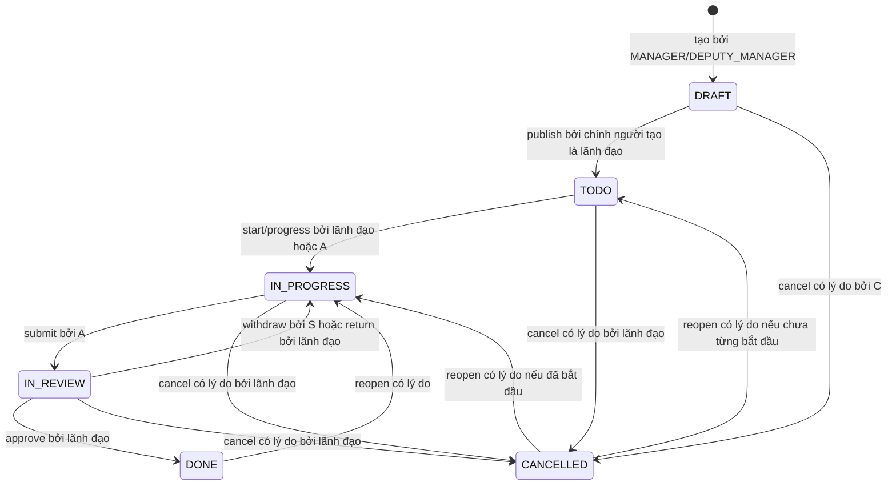

# BE-00-02 — Ma trận quyền và vòng đời nhiệm vụ

**Nguồn:** [Phase 00 D-01, D-09, D-11](../PHASE_00_CONTRACT.md); đặc tả §2, §4, §15; handoff §6.2; Phase 02–04/09. Quy tắc trong tài liệu này thay thế guard MANAGER-only của prototype `TaskService`. Mọi quyền cần cả role, trạng thái bản ghi và quan hệ với bản ghi. Tài khoản `LOCKED` không được tạo phiên hay tiếp tục gọi API.

## Ký hiệu và phạm vi đọc

- `L`: `MANAGER` hoặc `DEPUTY_MANAGER` đang ACTIVE; cùng quyền điều hành OFFICIAL. `M`: riêng MANAGER cho quản trị hệ thống. `C`: người tạo; `A`: chủ trì hiện tại; `S`: người nộp submission hiện hành; `P`: participant ACCEPTED. `—`: không được phép.
- OFFICIAL DRAFT chỉ `C` nhìn thấy, kể cả lãnh đạo khác. OFFICIAL đã phát hành: `L`, `C`, `A`, `P` nhìn thấy; `C` là STAFF không tự có quyền điều hành. `CANCELLED`/`DONE` giữ quyền đọc theo quan hệ hiện tại.
- TEAM: `C`, `A`, `P` nhìn thấy. Người được mời `PENDING` chỉ nhận projection lời mời gồm `participantId`, mã, tiêu đề rút gọn, người mời, thời điểm, hạn phản hồi; không nhận mô tả, file, bình luận, event, số liệu. `DECLINED` không được xem TEAM nếu không có quan hệ khác.
- PERSONAL chỉ `C` đọc/ghi; MANAGER không mặc nhiên có quyền. Người chủ trì cũ mất quyền ngay sau chuyển giao nếu không còn là `C` hoặc `P`; notification cũ không cho phép mở lại entity. Project, calendar, search, report, file, socket cùng dùng policy này; lọc ACL trước `total` và aggregation.
- API trả `403` khi role không được phép với hành động; ID bản ghi không tồn tại hoặc không đọc được trả `404` để không dò ID. Với bản ghi đã nhìn thấy nhưng quan hệ không đủ để thực hiện hành động, trả `403`. Trạng thái thay đổi trước command trả `409`.

## Quyền đọc và quản trị (Phase 02/03/07)

| Action/endpoint | MANAGER | DEPUTY_MANAGER | STAFF | Điều kiện bản ghi |
|---|---|---|---|---|
| Login/refresh/logout/logout-all/me | Tự phiên | Tự phiên | Tự phiên | Email/mật khẩu nội bộ; phiên ACTIVE, token hợp lệ |
| `GET/PATCH /auth/me`, đổi mật khẩu | Tự mình | Tự mình | Tự mình | Chỉ trường hồ sơ cho phép; không tự đổi role/status |
| `GET /users`, `GET /users/:id` | Danh bạ đầy đủ | Danh bạ đầy đủ | Projection danh bạ ACTIVE | Không lộ hash/session; STAFF không có dữ liệu quản trị |
| `POST /users`, `PATCH /users/:id`, reset mật khẩu | M | — | — | Không tự khóa; không hạ/khóa MANAGER ACTIVE cuối cùng |
| `GET /users/:id/workload` | Mọi người | Mọi người | Chính mình | Chỉ OFFICIAL hợp lệ; bộ lọc thời gian nhất quán |
| `GET /tasks`, `/tasks/:id`, comments, submissions, approvals, events | Theo policy | Theo policy | Theo policy | DRAFT/PERSONAL/TEAM PENDING như trên; lịch sử chỉ trong task đọc được |
| `GET /dashboard/stats?scope=DEPT`, báo cáo toàn phòng/xuất | Có | Có | — | Chỉ OFFICIAL đã phát hành; không lộ PERSONAL/TEAM |
| `GET /dashboard/stats?scope=STAFF`, báo cáo cá nhân | Chính mình | Chính mình | Chính mình | Cùng policy task, không xem thống kê người khác |
| `GET /settings` | Có | Có | Có | Cấu hình công khai trong phòng, bỏ thông tin bí mật |
| `PATCH /settings`, `GET /audit-logs`, `GET /backup` | M | — | — | Audit quản trị tách khỏi task event; backup chỉ metadata an toàn |
| `GET /files`, `/files/:id/download-url` | Theo entity | Theo entity | Theo entity | File READY có liên kết còn hiệu lực; quyền kiểm tra lại tại thời điểm cấp URL |
| `POST /files/upload-url`, `/complete`; `DELETE /files/:id` | Theo entity | Theo entity | Theo entity | Upload cần quyền ghi task và uploader là actor; remove do uploader hoặc lãnh đạo có quyền trên task; không xóa link người khác ngoài quyền |
| `GET /notifications`, read-one/read-all | Chính mình | Chính mình | Chính mình | Không tiết lộ entity nếu quyền task/chat đã bị thu hồi |

## Command nhiệm vụ: role × loại × status × quan hệ

| Command/endpoint | Loại · status đầu vào | MANAGER | DEPUTY_MANAGER | STAFF | Điều kiện và kết quả |
|---|---|---|---|---|---|
| `POST /tasks` | OFFICIAL · mới | L | L | — | Tạo DRAFT, `C` từ phiên; mã CV server sinh |
| `POST /tasks` | TEAM/PERSONAL · mới (P1) | C | C | C | PERSONAL không participant; mã NH/CN |
| `POST /tasks/:id/publish` | OFFICIAL · DRAFT | L nếu C | L nếu C | — | Cần title, deliverable, A ACTIVE, dueAt; `TODO`, assignedAt |
| `PATCH /tasks/:id` | OFFICIAL · DRAFT | L nếu C | L nếu C | — | Chỉ metadata; trường hệ thống không nhận từ body |
| `PATCH /tasks/:id` | OFFICIAL · TODO/IN_PROGRESS/IN_REVIEW | L | L | — | Metadata không gồm dueAt/A/status; ghi event |
| `PATCH /tasks/:id` | TEAM/PERSONAL · chưa DONE/CANCELLED (P1) | C | C | C | Chỉ C; không tạo đường ghi vào OFFICIAL |
| `POST /tasks/:id/start` | OFFICIAL · TODO | L | L | A | Sang IN_PROGRESS |
| `POST /tasks/:id/progress` | OFFICIAL · TODO/IN_PROGRESS | L | L | A | 0–100; `isBlocked=true` cần lý do; TODO → IN_PROGRESS khi tiến độ bắt đầu; 100% không tự DONE |
| `POST /tasks/:id/submissions` | OFFICIAL · IN_PROGRESS | Chỉ khi A | Chỉ khi A | A | Summary bắt buộc; file READY thuộc task; tạo submission mới PENDING, sang IN_REVIEW |
| `POST /tasks/:id/submissions/:submissionId/withdraw` | OFFICIAL · IN_REVIEW | Chỉ khi S | Chỉ khi S | S | Chỉ submission hiện hành PENDING; sang IN_PROGRESS, submission WITHDRAWN |
| `POST /tasks/:id/approve` | OFFICIAL · IN_REVIEW | L | L | — | Submission PENDING hiện hành; DONE; snapshot hạn và dấu duyệt |
| `POST /tasks/:id/return` | OFFICIAL · IN_REVIEW | L | L | — | Lý do bắt buộc; submission RETURNED; sang IN_PROGRESS |
| `POST /tasks/:id/adjust` | OFFICIAL · TODO/IN_PROGRESS/IN_REVIEW | L | L | — | Chỉ dueAt/A/priority, lý do bắt buộc; nếu đang IN_REVIEW không thay submission hiện hành; event before/after |
| `POST /tasks/:id/cancel` | OFFICIAL · DRAFT/TODO/IN_PROGRESS/IN_REVIEW | L; DRAFT chỉ C | L; DRAFT chỉ C | — | Lý do bắt buộc; CANCELLED; dừng nhắc |
| `POST /tasks/:id/reopen` | OFFICIAL · DONE/CANCELLED | L | L | — | Lý do bắt buộc; D-09; xóa dấu hoàn thành hiện tại, giữ lịch sử; CANCELLED từ DRAFT cần đủ dữ liệu publish trước khi sang TODO |
| `GET/POST /tasks/:id/comments` | OFFICIAL · đã phát hành, chưa CANCELLED | Nếu đọc được | Nếu đọc được | Nếu đọc được | POST cần quyền đọc đầy đủ; tác giả từ phiên; DONE chỉ đọc |
| `POST /tasks/:id/invitations/:participantId/respond` | TEAM · PENDING (P1) | Đúng người mời | Đúng người mời | Đúng người mời | ACCEPTED hoặc DECLINED; không được đọc task trước ACCEPTED |
| `POST /tasks/:id/start`, `/progress` | TEAM/PERSONAL · TODO/IN_PROGRESS (P1) | C hoặc A theo loại | C hoặc A theo loại | C hoặc A theo loại | PERSONAL chỉ C; TEAM C hoặc A; participant khác chỉ đọc/bình luận |
| `POST /tasks/:id/complete` | TEAM/PERSONAL · IN_PROGRESS (P1) | C hoặc A theo loại | C hoặc A theo loại | C hoặc A theo loại | Không qua duyệt; server đặt completedAt; PERSONAL chỉ C |
| `POST /tasks/:id/cancel`, `/reopen` | TEAM/PERSONAL · trạng thái phù hợp (P1) | Chỉ C | Chỉ C | Chỉ C | Lý do bắt buộc; reopen theo D-09, giữ history |
| `POST /tasks/:id/convert-official` | TEAM · đang hoạt động (P1) | L | L | — | Kiểm tra quyền trên TEAM theo quy tắc chuyển; cấp mã CV mới, giữ mã NH trong event |
| `DELETE /tasks/:id` | PERSONAL · đang hoạt động (P1) | Chỉ C | Chỉ C | Chỉ C | Soft delete; không chạm OFFICIAL |
| `POST /tasks/:id/subtasks` | OFFICIAL/TEAM · chưa DONE/CANCELLED (P1) | L nếu OFFICIAL; A/C nếu TEAM | Như MANAGER | A của task cha | Tối đa 2 cấp; hạn con không vượt cha; cha không tự DONE |
| `POST /tasks/:id/deadline-requests` | OFFICIAL · TODO/IN_PROGRESS (P1) | A | A | A | Một PENDING/loại/task; proposedDueAt > hạn hiện tại |
| `POST /tasks/:id/assignee-requests` | OFFICIAL · TODO/IN_PROGRESS (P1) | A | A | A | Một PENDING/loại/task; người mới ACTIVE |
| `POST .../:requestId/decision` | OFFICIAL · request PENDING (P1) | L | L | — | Chỉ APPROVED đổi task; REJECTED giữ nguyên; transaction |

Với các command TEAM/PERSONAL chưa mở P0, Phase 09 phải chuẩn hóa transition riêng trước khi bật API thật. `TaskService` hiện cho `createdById` can thiệp quá rộng ở vài command OFFICIAL; backend dùng ma trận này. Lãnh đạo chỉ có quyền submit/withdraw khi đồng thời là A/S; quyền điều hành không thay thế quan hệ người nộp.

TEAM/PERSONAL ở P1 dùng `TODO → IN_PROGRESS → DONE` qua `/start` hoặc `/progress`, rồi `/complete`. Không tạo `TaskApproval`; `CANCELLED → TODO/IN_PROGRESS` và `DONE → IN_PROGRESS` khi C mở lại có lý do. TEAM participant ACCEPTED chỉ đọc/bình luận; việc thực hiện thuộc C hoặc A. PERSONAL luôn chỉ C.

## Quyền P1 ngoài task

| Action | MANAGER | DEPUTY_MANAGER | STAFF | ACL bản ghi |
|---|---|---|---|---|
| Project create/update/archive | Có | Có | — | Lãnh đạo điều hành; `ownerId` từ phiên lúc tạo, archive giữ task/history |
| Project list/detail, calendar | Theo task | Theo task | Theo task | Lãnh đạo thấy metadata project; STAFF thấy project có task được xem hoặc do mình sở hữu, nhưng chỉ các task qua ACL |
| Recurrence rule create/update/toggle/delete/generate | Có | Có | — | STAFF không sinh kỳ; unique `(ruleId,periodKey)` |
| Recurrence rule/instance read | Có | Có | Kỳ liên quan | STAFF chỉ thấy rule/kỳ được giao; task phát sinh vẫn qua ACL |
| Chat create room, list/read/send/read marker | Thành viên | Thành viên | Thành viên | Tạo room bằng người dùng ACTIVE; sau đó chỉ member hiện tại đọc/gửi/join socket/tải file |

## State machine OFFICIAL

| Transition | Điều kiện thêm | Ghi lịch sử |
|---|---|---|
| Publish | DRAFT hợp lệ; một người A ACTIVE; dueAt hợp lệ | `PUBLISHED`, assignedAt, notification |
| Start/progress | TODO/IN_PROGRESS; trạng thái vướng mắc không làm đổi status | `STARTED`/`PROGRESS_UPDATED`/`BLOCKED`/`UNBLOCKED` |
| Submit | IN_PROGRESS; summary; file READY được quyền | Submission PENDING mới, `SUBMITTED`, notification |
| Withdraw/return | Chỉ submission hiện hành chưa có quyết định; RETURN cần lý do | Giữ submission; `SUBMISSION_WITHDRAWN`/`RETURNED` |
| Approve | Chính submission hiện hành; race hai lãnh đạo chỉ một thắng | Approval APPROVED, `APPROVED`, snapshot dueAt, completedAt |
| Adjust | Không qua generic PATCH; lý do và before/after | `DEADLINE_CHANGED`/`ASSIGNEE_CHANGED`/`PROGRESS_UPDATED` theo trường thực đổi |
| Cancel/reopen | Lý do bắt buộc; mọi lịch sử giữ nguyên. Nếu cancel khi IN_REVIEW, submission PENDING hiện hành được đóng WITHDRAWN với lý do hệ thống; không để yêu cầu còn treo. Reopen từ DRAFT đã hủy cần đạt điều kiện publish trước TODO. | `CANCELLED`/`REOPENED`; reset completedAt/approvedAt/approvedById/snapshot khi mở lại DONE |

Mỗi command kiểm tra version hoặc khóa hàng trong transaction. Command lặp sau khi state đã đổi trả `409` (hoặc cùng kết quả nếu có idempotency key hợp lệ đã lưu), không tạo event/notification trùng. `PATCH /tasks/:id` không nhận status, dueAt, primaryAssigneeId, approvedById, completedAt. `DONE/CANCELLED` chỉ được đọc, cancel/reopen theo bảng; không cập nhật tiến độ. Submission/approval/event đã ghi là append-only.
